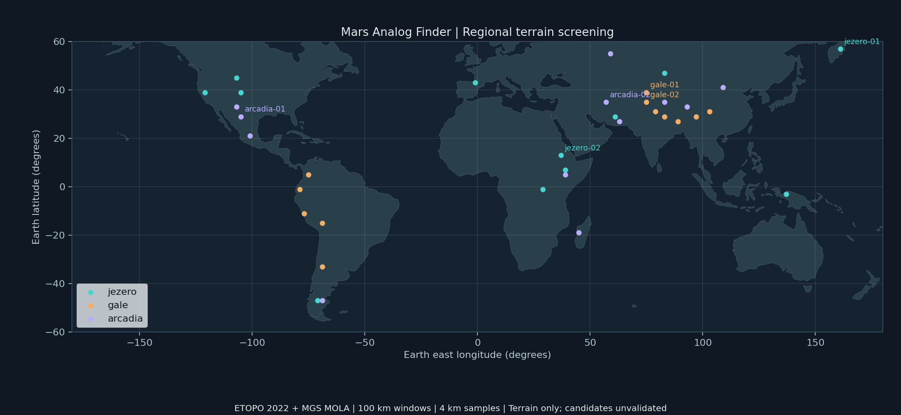

# Mars Analog Finder

### Earth–Mars analog research · NASA Space Apps 2026 Taipei · Team zasa

以開放地形資料搜尋地球候選區域，對照火星目標，並公開推薦依據、資料缺口與類比限制。

[研究方法](docs/README.md) · [候選結果](outputs/analysis/candidate_handoff.md) · [火星資料](outputs/mars_profiles/handoff.md) · [資料導覽](data/README.md) · [協作方式](CONTRIBUTING.md)

> 目前是研究管線與候選分析原型。區域地形搜尋已產生結果，四面向綜合評分與互動網站尚未完成；本 repo 不代表 NASA 認證或已完成競賽提交。

## 先看結果



圖中候選來自稀疏區域地形搜尋，尚待地質、環境與既有研究查證。圖示不能證明著陸安全、場址新穎性或任務成功率。

| 工作項目 | 目前狀態 | 可檢查內容 |
|---|---|---|
| 相同物理尺度的地形比較 | 已有實際結果 | [方法](docs/earth_pipeline.md)、[候選與限制](outputs/analysis/candidate_handoff.md) |
| 火星 MOLA／TES／SWIM／沙塵描述 | 已接入 | [方法](docs/mars_pipeline.md)、[來源與數值](outputs/mars_profiles/profiles.json) |
| 日夜地面亮溫 | 探索用途，品質不完整 | [MEDA 說明](docs/mars_temperature.md)、[品質紀錄](outputs/mars_temperature/summary.json) |
| 地球多面向原始資料 | 隊友提供清單，原始檔未全數在本機 | [逐檔清單](docs/earth_inventory.csv)、[交接](docs/data_handoff.md) |
| 四面向整合／場址驗證 | 尚未完成 | [物理量對照](docs/cross_reference.md) |
| 互動工作台／正式簡報／提交 | 尚未完成 | [簡報草稿](docs/presentation_outline.md) |

## 本機執行

需要 Python 3.11 以上；前輪使用 Python 3.12。以下在專案根目錄執行：

```bash
python3.12 -m venv .venv
.venv/bin/python -m pip install -e ".[dev]"
.venv/bin/python -m scripts.profile_mars --strict
.venv/bin/python -m scripts.process_mars_temperature
.venv/bin/python -m pytest -q
.venv/bin/ruff check .
```

火星原始資料與既有輸出已進版控。`profile_mars` 與溫度處理命令會重建相應輸出；只想閱讀結果時直接開啟上述連結即可。`--strict` 檢查核心網格來源，不代表 MEDA 品質通過。

地球搜尋需要另外取得 ETOPO／陸地遮罩等輸入，見 [地球執行說明](docs/earth_pipeline.md)。Earthdata 產品可能需要帳號；不要把登入檔放入 Git。環境版本紀錄見 [requirements-lock.txt](requirements-lock.txt)，跨平台安裝相容性仍需各自確認。

## 專案結構

```text
analog/       科學資料讀取、尺度處理與分析模組
scripts/      下載、處理、匯出與繪圖入口
tests/        資料與方法檢查
data/         火星原始／處理資料；地球大檔另行交接
outputs/      既有候選、來源、敏感度、火星描述與圖表
docs/         方法、資料規格、競賽準備與歷史紀錄
```

各目錄的用途與保留理由見 [資料導覽](data/README.md)、[結果導覽](outputs/README.md) 與 [檔案盤點](docs/repository_inventory.csv)。

## 科學邊界

- Earth 與 Mars 比較以公里尺度定義窗口，不能直接視為相同角度網格。重採樣不會新增真實細節。
- MODIS LST、MEDA 地面亮溫、POWER 2 m 氣溫與 TES 熱慣量是不同量，不能直接互相代替。
- SWIM 一致性不是冰含量或機率；永凍土比例不是可採冰量；低 NDVI 不是無生命證明。
- Earth 550 nm extinction AOT 與 Mars 9.3 μm absorption CDOD 不能直接等量比較。
- 未知與未通過品質檢查的證據不得算作確認符合。已知地形相近，也不表示成因、礦物或任務適用性相同。

## 來源、授權與競賽準備

來源、版本、單位與處理見 [文件索引](docs/README.md) 及各結果 manifest。沙塵衍生資料依 [CC-BY-SA 說明](outputs/mars_profiles/LICENSE-data.md) 使用；其他產品依原提供者條件，不能整批套用同一授權。程式目前尚無明確根目錄授權檔，提交前需由團隊確認採用的程式授權。

[官方挑戰頁](https://www.spaceappschallenge.org/2026/challenges/permanent-moon-base-locations-and-mars/) · [官方條款](https://www.spaceappschallenge.org/legal/)

頁數、影片、開發時段、AI 揭露格式與提交時間仍需依當次官方完整規則核實。既有七頁簡報是草稿規劃，不作為官方規則證明。

## 工作報告（繁體中文）

後續每次工作在此追加完成項目、實際驗證、問題與下一步。歷史報告與 AI 使用紀錄完整保留於 [整理前紀錄](docs/archive/README_before_cleanup_2026-11-14.md)，另見 [地球工作報告](docs/work_report_2026-11-14.md) 與 [MEDA 工作報告](docs/mars_temperature.md)。六階段提示詞已整理，階段任務未因此自動執行。

### 2026-11-14：提交用儲存庫整理

- 已完成：重整 README、建立文件／資料／結果導覽與逐檔用途清單；歷史紀錄移入 archive，保留引用與 AI 揭露。
- 清理：移除本機可重建快取；沒有刪除科學來源、敏感度對照、測試或來源紀錄。10 km 結果仍被摘要腳本引用，不能當成多餘資料。
- 限制：尚未建立互動介面、完成四面向選址或競賽提交；本次沒有重新排名或修改科學數值。
- 待處理：團隊確認程式授權、正式競賽規則、地球原始檔交接，以及 MEDA 品質旗標。
- AI 使用：OpenAI Codex 協助檔案盤點、導覽與中文報告整理。本輪 57 項測試通過（8 個既有警告）、Ruff 通過，新增導覽與歷史快照的本機連結檢查通過。

### 2026-11-14：三組火星—地球候選研究

[完整研究報告](docs/research_report_three_analogs_2026-11-14.md)與[可追溯證據](outputs/research/three_candidate_evidence.json)已建立。選出 Gale—39°N、75°E，以及 Arcadia—29°N、105°W、35°N、57°E，共三個地球候選、兩個火星目標。既有 Jezero 候選暫留地形參照，沒有強行宣稱乾燥環境匹配。

本輪依既有特徵重算三個地形距離，均與既有值一致；統計四個配置的前二名保留次數為 4/4、3/4、2/4，不代表信賴度。來源、窗口、氣候背景與研究限制均附於報告。地質／礦物、地下冰、文獻新穎性與後勤尚待驗證，沒有重新排名或宣稱 NASA 認證。重現命令：`.venv/bin/python -m scripts.report_candidate_evidence`。

### 2026-11-14：第一組候選地質與礦物查證

已更新[研究報告第 3 節](docs/research_report_three_analogs_2026-11-14.md)。Bershaw et al.（2012）的三個 Oytag 泥岩、砂岩、石灰岩樣點均落在 39°N、75°E 的 100 km 窗口東側；[座標摘錄](outputs/research/oytag_literature_points.csv)及[雙重空間核對](outputs/research/oytag_overlap.json)已保存。

這支持局部沉積岩研究。石膏仍是剖面級文獻證據，精確露頭未核對；蒙皂石與氧化鐵配對未確認，海相／河流背景也不能直接等同 Gale 湖泊。未新增礦物分數或改動排名。下一步優先取得地層圖與同露頭礦物鑑定，而非宣稱完整 Gale 類比已成立。

實際執行：`.venv/bin/python -m scripts.check_oytag_overlap`，三點均通過局部 ±50 km 與既有多邊形包含檢查。座標 datum 未註明，結果只供研究尺度歸屬。AI 協助文獻核對、座標計算與中文報告；未產生衛星影像或礦物量測。

### 2026-11-14：TerraMatch Mission Lab 本機互動工作台建置

已完成 `web/`（React 18 + TypeScript + Vite）第一版本機互動工作台（簡潔英文介面），藉由 `web/scripts/build_workbench_data.py`（`npm run build:data`）與 `web/src/data/adapter.ts` 串接 `outputs/analysis/results_with_context.json`、`outputs/analysis_scale10km/results.json`、`outputs/analysis/sensitivity.json`、`outputs/mars_profiles/profiles.json` 及 `outputs/mars_temperature/summary.json`，未修改 `analog/`、`scripts/`、`data/` 或既有 `outputs/` 結果，亦未重新排名或改動科學模型。

- **已完成**：目標與任務列（`jezero`、`gale`、`arcadia` 切換並自動清除舊狀態、獨立隔離 Demo Mode）、雙側獨立座標地圖（Earth `R = 6,371.0 km`、`Δlat = 0.90° / 100 km` vs. Mars `R = 3,396.0 km`、`Δlat = 1.69° / 100 km`，明示無 Mars 底圖並可展開 `candidate_map.png` 與各目標 `*_terrain_comparison.png`）、12 筆候選清單與篩選器（含 `No qualifying candidates` 空狀態）、四大主題證據矩陣（共 8 項指標，獨立列出火星 `surface_temperature: missing` 缺口、置頂不可直接比較物理量護欄、缺值不補零）、可存取 `EvidenceDrawer`（含 DOI／PDS 網址與 SHA-256 校驗碼）及 4 組態真實敏感度面板（Top-2 頻率明標非機率或信賴度）。
- **本機執行**：於 `web/` 執行 `npm install`、`npm run build:data`、`npm run build`，並以 `npm run dev` 或 `npx vite preview --port 4173 --host 127.0.0.1` 啟動。
- **實際驗證**：`cd web && npm run build:data` 與 `npm run build`（`tsc -b && vite build`）通過；`.venv/bin/ruff check .` 通過；於 `http://127.0.0.1:4173/` 實機瀏覽器驗證桌面（1280×800）與窄螢幕（390×844）共 7 項互動流程、邊界座標與動態圖表載入全數通過（0 console errors、0 失敗網路請求）。
- **限制與下一步**：目前科學篩選仍為 `terrain_only_screening`，Ranks #3–#12 尚未查取 NASA POWER 氣候背景，火星區域 `surface_temperature` 仍為 `missing`；後續若擴充多變量評分或新證據，可重新執行 `npm run build:data` 更新前端資料包。
- **AI 使用**：Antigravity 協助建置與審查強化 `web/` 前端與資料轉接程式、執行建置與瀏覽器實機驗證並追加本節報告；未生成虛構科學數據或改動既有排名。

### 2026-11-14：Oytag 石膏層定位與同露頭鑑定續查

已補入[研究報告 §3.7](docs/research_report_three_analogs_2026-11-14.md)：讀取 Sun/Jiang（2013）Fig.2 經緯網定位圖、Fig.3 含石膏剖面，近似讀取 A–B 路線；兩端與八種 ±8 pixel 診斷情境均在候選窗口內。這支持含石膏剖面位於範圍內的圖上推論，尚無石膏 GPS，不是精密地質套疊。

[空間計算](outputs/research/oytag_transect_check.json)、[原創示意圖](outputs/research/oytag_transect_schematic.png)及[來源查證清單](outputs/research/oytag_outcrop_source_audit.json)已保存。熱磁分析、石灰岩 Ca/Sr、附近薄片都不能替代同一石膏露頭的 XRD；2012 與 2013 研究亦不能因同名剖面就串成同一樣品。未找到完整「石膏層座標—樣品 ID—礦物鑑定」鏈，蒙皂石共現仍未知。

已執行 `.venv/bin/python -m scripts.check_oytag_overlap` 與 `.venv/bin/python -m scripts.check_oytag_transect` 核對空間結果，並檢查圖表與文件連結。本輪未重跑科學排名或整套測試。下一步需原始接觸點／樣品 GPS 與同樣品礦相資料。OpenAI Codex 協助 PDF 圖件閱讀、近似座標診斷及中文紀錄；原文 PDF 未重新散布。
