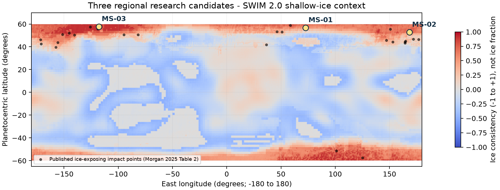

# ZASA | Mars Reconnaissance Candidates

NASA Space Apps 2026 · Team zasa

> **本輪正式報告由人類撰寫。** 下方既有報告／PDF是歷史參考；最新研究資料與限制見[目前採用紀錄](docs/integration/science/current_notes.md)及[三點新版比較表](outputs/integration/science/comparison_current.csv)。模型冰深不等於實測，三點冰真值仍未知。

Three regional targets for follow-up investigation of shallow subsurface ice. The team selected **MS-01, MS-02 and MS-03** on 14 November 2026 after a new inventory of available Mars data, unweighted trade-off screening, native-grid checks and a bounded prior-site review.

**These are conditional research targets.** A non-hit in the inspected catalogs does not establish that a place has never been studied or proposed. Ice presence, depth, quantity, extractability and landing safety remain unverified.

## The three selected targets

| Target | Center (planetocentric latitude, east-positive longitude) | Why retain it? | Main trade-off |
|---|---|---|---|
| **MS-01** | **56.75°N, 72.75°E** | Positive, relatively strong ice-consistency descriptors in both depth zones; low regional relief | 73/100 native TES cells remain after excluding interpolation; local material and ice truth unknown |
| **MS-02** | **52.75°N, 168.25°E** | Lowest latitude of this three-case set; positive ice descriptors and the most complete TES support | Higher MY34 dust p95 and greater regional relief than the other two |
| **MS-03** | **57.75°N, 242.25°E** | Lowest regional mean slope and reconstructed dust in this set; strong shallow-ice descriptor | Lower 1-5 m consistency; partial TES support and coarse, sparse temperature context |

## Read the results

- [Historical English reference report](docs/REPORT.md)
- [歷史中文報告 PDF（非本輪正式稿）](outputs/research/mars_reselection_20261114/mars_three_candidates_report_zh.pdf) · [歷史中文文字版](outputs/research/mars_reselection_20261114/report.md)
- [Three-target data table](outputs/research/mars_reselection_20261114/final_candidates.csv) · [Target footprints](outputs/research/mars_reselection_20261114/selected_targets.json)
- [Every data product and its role](outputs/research/mars_reselection_20261114/all_data_usage.csv)
- [Bounded prior-site checks and search scope](outputs/research/mars_reselection_20261114/bounded_prior_site_audit.json)
- [Numerical checks](outputs/research/mars_reselection_20261114/numerical_validation.json) · [Report checks](outputs/research/mars_reselection_20261114/report_validation.json)
- [Reproduce the analysis](docs/REPRODUCE.md) · [Data attribution and terms](DATA_LICENSES.md)

## What was considered

MOLA elevation, slope and relief; TES thermal inertia and interpolation mask; both available SWIM depth-zone products; MY34 and MY35 dust time series, seasons, p95, maxima and reliability; MCS time-adjusted 03:00/15:00 temperature context; and the availability/quality limits of rover-local MEDA records.

Six directional descriptors were used for exploratory trade-offs. Other variables were retained as context or limitations instead of being forced into a scalar suitability score. Missing local wind, pressure, material, ice ground truth and fine hazards remain unknown.

All three targets are above 50°N. They do **not** meet the latitude envelope used by the cited MCOA2025 study or the current SkyFall design. This work is scoped to ice-investigation research; it does not recommend a validated crewed base or a mission-approved landing site.

## Clean-code rebuild

The clean package was tested from checksum-verified public source files. Its rebuilt global NetCDF is not byte-identical and has small measured floating-point differences, which are disclosed in [the rebuild comparison](outputs/research/mars_reselection_20261114/cleanup_rebuild_validation.json). Pool/front memberships and the 22 review coordinates were unchanged; 88 non-stack native numerical columns and both dust/MCS sequence files reproduced exactly. The frozen report retains its original version; active scripts use v1-clean.

## Repository scope

This main branch contains the selected three-target research release, its evidence and the minimum code needed to reproduce it. Large downloaded source grids are obtained from their providers and verified using the input manifest.

The current Earth-analog evidence is merged under docs/research/MS-01 through MS-03 and their outputs. Earlier exploratory rankings, website and deployment history remain in the [pre-cleanup archive](https://github.com/zhuang768/NASA-Space-Apps-Challenge-2026-Taipei/tree/archive/pre-msr-cleanup-20261114). The original Earth-analog discovery objective remains separate from this Mars-target update.

The PDFs and original report manifests are frozen as-produced records. Their statements about the earlier local-only delivery describe the time they were generated. The current GitHub release state is recorded in [CURRENT_STATUS.json](CURRENT_STATUS.json).

This is an independent team research project, not NASA endorsement or certification. Original observations remain attributed to their providers. AI assisted code, checks and writing; actual execution used Mac CPU, without GPU acceleration or model training.
