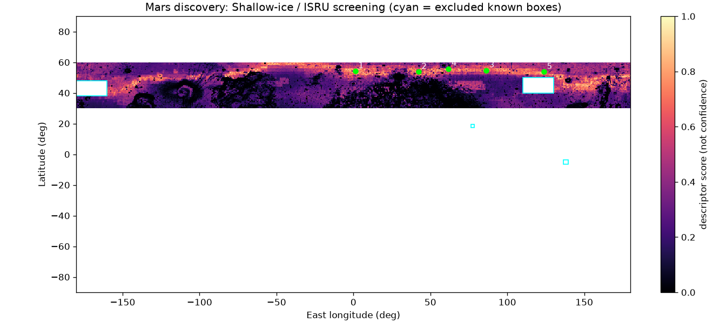

# Mars Analog Finder

### Earth–Mars analog research · NASA Space Apps 2026 Taipei · Team zasa

Search open terrain data for Earth candidate regions, compare them with Mars targets, and expose the supporting evidence, missing data and limits of each analogy.

**[Live dashboard → nasa-space-apps-challenge-2026-taipei.ziz81503.workers.dev](https://nasa-space-apps-challenge-2026-taipei.ziz81503.workers.dev)** · [Methods](docs/README.md) · [Mars discovery](outputs/mars_discovery/README.md) · [Research handoff](docs/mars_discovery_handoff.md) · [Mars data](outputs/mars_profiles/handoff.md) · [Data guide](data/README.md) · [Contributing](CONTRIBUTING.md)

> **Status:** four Mars reporting references are available. Earth pairing and same-purpose novelty checks remain research work; validated four-theme scoring is unfinished. Not NASA-endorsed, and the competition submission is not complete. Earth–Mars-only scope is a locked team decision.

## Results



Current reporting references are I-01, I-02, D-03 and D-04. They require environmental, geological and prior-literature verification. The map does not establish landing safety, novelty or mission success. Previous Jezero/Gale/Arcadia Earth rankings and their 4 km / 10 km comparison outputs have been removed at the owner's request.

| Workstream | Status | Evidence |
|---|---|---|
| Common physical-scale terrain methods | Methods retained; previous ranking outputs removed | [Method](docs/earth_pipeline.md) |
| Mars MOLA / TES / SWIM / dust context | Integrated | [Method](docs/mars_pipeline.md), [sources and values](outputs/mars_profiles/profiles.json) |
| Regional day/night temperature context | New coarse MCS time-corrected derivative; unscored and metadata incomplete | [Source, extraction and remaining gaps](outputs/mars_regional_temperature/README.md) |
| Rover day/night brightness temperature | Exploratory; incomplete quality support | [MEDA method](docs/mars_temperature.md), [quality summary](outputs/mars_temperature/summary.json) |
| Multi-theme Earth raw data | Teammate inventory; complete batch not on this machine | [Inventory](docs/earth_inventory.csv), [handoff](docs/data_handoff.md) |
| Four-theme scoring and field-site validation | Unfinished | [Quantity comparison](docs/cross_reference.md) |
| Interactive workbench | Official site on the team Cloudflare Worker; auto-deploy from `main` waits for the team API token | [Public site](#public-site-cloudflare), [deployment check](docs/deployment_check_2026-11-14.md) |
| English presentation and official submission | Previous slide draft removed; final materials pending | [Submission preparation](docs/submission/preparation.md) |

## Run locally

Python 3.11 or later is required; previous runs used Python 3.12. Run from the repository root:

```bash
python3.12 -m venv .venv
.venv/bin/python -m pip install -e ".[dev]"
.venv/bin/python -m scripts.profile_mars --strict
.venv/bin/python -m scripts.process_mars_temperature
.venv/bin/python -m pytest -q
.venv/bin/ruff check .
```

Existing Mars inputs and outputs are versioned. Processing commands rebuild their outputs; use the linked files directly when reading results. `--strict` checks core grid inputs, not MEDA quality acceptance.

Website (`web/`, Node 22):

```bash
python3 web/scripts/build_workbench_data.py   # rebuild the data bundle from outputs/
cd web && npm ci && npm run dev               # http://127.0.0.1:5173
```

Earth screening additionally needs ETOPO and the land mask; see [Earth execution](docs/earth_pipeline.md). Some Earthdata products require an account. Never commit credentials. [requirements-lock.txt](requirements-lock.txt) records the tested environment; cross-platform installation still requires verification.

```text
analog/       Scientific readers, scale handling and analysis
scripts/      Download, processing, export and plotting entry points
tests/        Data and method checks
data/         Mars inputs and processed data; large Earth files handed off separately
outputs/      Candidates, provenance, sensitivity, profiles and figures
docs/         Methods, data contracts, submission drafts and historical records
web/          TerraMatch Mission Lab: React + Vite workbench built from outputs/
```

See the [data guide](data/README.md), [output guide](outputs/README.md) and [file inventory](docs/repository_inventory.csv).

## Public site (Cloudflare)

| Item | Value |
|---|---|
| Official URL | [nasa-space-apps-challenge-2026-taipei.ziz81503.workers.dev](https://nasa-space-apps-challenge-2026-taipei.ziz81503.workers.dev) |
| Cloudflare account | Team account "zizi" |
| Account ID | `5a215a2a3ffc384e958ae5bcb53687d0` (not a secret) |
| Service | Workers & Pages → Worker `nasa-space-apps-challenge-2026-taipei` (static assets only) |
| Config | Root [`wrangler.jsonc`](wrangler.jsonc): Worker name, assets from `web/dist`, single-page-app fallback |
| Auto-deploy | [`.github/workflows/cloudflare-pages.yml`](.github/workflows/cloudflare-pages.yml): every push to `main` builds `web/dist`, stamps `deployment.json`, runs `wrangler deploy`, then checks the live URL serves that commit |
| Retired | `terramatch-mission-lab.pages.dev` (personal account) is no longer updated; do not share it |

**Repository secrets** (Settings → Secrets and variables → Actions; values are pasted in GitHub only, never committed):

- `CLOUDFLARE_ACCOUNT_ID` = the team account ID above.
- `CLOUDFLARE_API_TOKEN` = a token created in the team account (My Profile → API Tokens → Create Token → *Edit Cloudflare Workers* template, scoped to the team account). Paste the token value only, with no quotes, spaces or command text.

Until both secrets are set, the workflow stops at "Validate deployment configuration" and the site changes only through a manual deploy. Use either GitHub Actions or Cloudflare's own Git build for this Worker, not both.

**Manual deploy** (needs Workers access to the team account):

```bash
python3 web/scripts/build_workbench_data.py
(cd web && npm ci && npm run build)
CLOUDFLARE_ACCOUNT_ID=5a215a2a3ffc384e958ae5bcb53687d0 npx wrangler deploy
```

## Scientific boundaries

- Define comparison windows in kilometers using the appropriate planetary radius. Equal angular grids do not imply equal physical support; interpolation creates no new detail.
- MODIS kinetic LST, MEDA ground brightness temperature, POWER 2 m air temperature and TES thermal inertia are different quantities.
- SWIM consistency is not ice amount or probability. Permafrost fraction is not extractable ice. Low NDVI is not evidence of lifelessness.
- Earth 550 nm extinction AOT is not directly equivalent to Mars 9.3 µm absorption CDOD.
- Missing or quality-incomplete evidence cannot count as confirmed support. Similar terrain statistics do not establish matching geology, origin or mission suitability.

## Sources, rights and submission

Versions, units and processing are documented in the [method index](docs/README.md) and output manifests. Dust-derived material has [separate CC-BY-SA terms](outputs/mars_profiles/LICENSE-data.md). Other products retain their providers' terms. An original-code license remains pending team confirmation; Apache-2.0 is a proposal, not an adopted license.

[Official challenge](https://www.spaceappschallenge.org/2026/challenges/permanent-moon-base-locations-and-mars/) · [Official terms](https://www.spaceappschallenge.org/legal/)

The official-repository Navigator reply supports preparing up to seven slides or a video of at most 30 seconds. The complete submission guide, account details and Taipei-specific requirements remain unverified. Drafts are not proof of submission. See the [remaining checklist](docs/submission/remaining_checklist.md).

## Current research

- [Selection principles](docs/site_discovery_brief.md) and [Mars research handoff](docs/mars_discovery_handoff.md).
- [Experimental Mars references](outputs/mars_discovery/README.md): I-01, I-02, D-03 and D-04.
- Team-specific research reports are under `docs/research/` on the branches where their authors publish them.
- Previous terrain-ranking outputs, matching exports, old slide drafts and work logs were removed. Scientific input data, source metadata, methods, rights records and the new Mars references remain.
- AI assistance and contribution records: [disclosures and rights](docs/submission/disclosures_and_rights.md).
