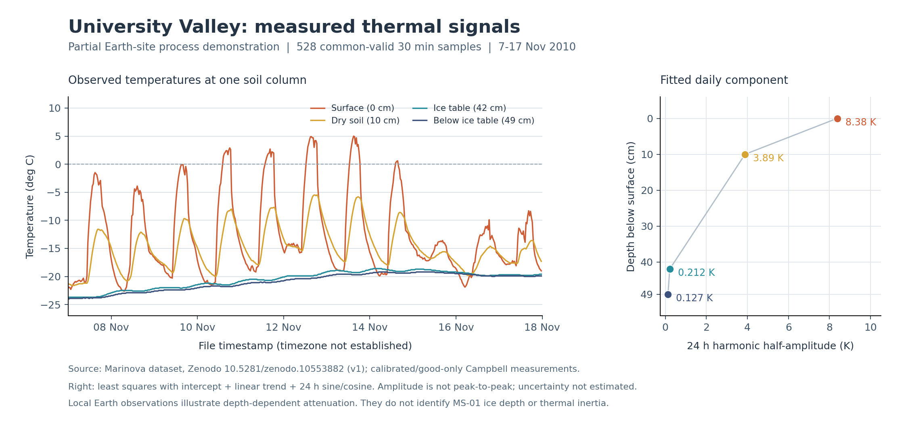

# MS-01 地球類比場址研究

Team zasa｜研究日期：2026-11-14（Asia/Taipei）｜火星中心：56.75°N、72.75°E

> **2026-11-15 熱訊號追問已完成：** 請接續閱讀 [四站共同期間、來源衝突與可辨識性分析](thermal_followup.md)。University Valley 保留為已知冰界面熱傳／模型判讀案例；仍不能唯一分離材料與冰。Beacon 為可選的塊狀冰／物性補充。以下為第一輪的基準與研究紀錄；遠端缺檔敘述限定當時固定 SHA，不代表現在所有分支的狀態。

## 結論與用途

保留兩個具有不同驗證用途的地球候選：**MS-01-E01 University Valley 測站網絡**，用已知冰界面深度與多深度溫度檢查熱訊號可辨識性；**MS-01-E02 central Beacon Valley 測溫多邊形**，用乾覆土下塊狀冰、土樣物性與既有模型研究界面傳熱及冰保存的邊界條件。兩者都是過程類比，沒有證據把任何一處稱為 MS-01 的整體環境複製品。

本次已完成原始火星產品重提取、地球公開校正序列的雜湊核驗與小型熱波分析、四面向比較、8筆先例查核和用途差異整理。Beacon 的逐時原始序列尚未取得，沒有聲稱重現其熱模型。已找到直接同場址同用途研究；本次價值是把已知真值對照轉成 **MS-01 下一步該量什麼、哪些推論目前做不到**，不主張新場址、新機制或全球首次配對。

## 共同基準與取得狀態

開始時透過 GitHub API 取得的 `origin/main`：

`3cc8488577535e2fa4d146021fde51f8ff6cc667`

遠端 tree：`bd190ecb1fae3259c235d309b010ebea91412251`。研究分支 `research/ms-01-earth-analogs` 直接從此 SHA 建立。既有本機 `main` 停在其他舊提交且有大量未提交修改，沒有切換、reset、合併或修改其 Git metadata；以 GitHub Git Data API 僅發布本人交付路徑。

**遠端尚未包含所述「補齊交接資料」版本。** 實際讀取 `docs/TEAM_START.md` 與 `outputs/handoff/` 回傳404，完整 recursive tree也沒有下表交接檔。依任務允許的缺件分支，固定開始的遠端 SHA 並繼續研究，沒有用本機檔的存在冒稱遠端可下載。

| 路徑 | 實際核對結果 | 對本次影響 |
|---|---|---|
| `docs/TEAM_START.md`、`scripts/restore_team_data.py` | 本機讀過；遠端基準缺件 | 研究邊界可讀，但隊友尚不能從該基準取得還原程式 |
| `outputs/consolidated/NASA_Space_Apps_2026_All_Data.xlsx` | 本機23,035,176 bytes，SHA-256 `157a108a08b8ca32ca52b40f3e9e80536431125cecfb838aa21223a933ac1175`；遠端無檔或三段part | 歷史Excel不參與新配對；不阻擋本次原始資料核對 |
| `outputs/research/mars_reselection_20261114/screened_pool.csv.gz` | 本機7,702,846 bytes，SHA-256 `7c5559e40fca9fa304b7799e4490bfb4ff0d55ea0a02819c53f432377462ff92`；遠端缺件 | 無法從共同遠端重現完整篩選池；本次只核對已選MS-01，不重選全球 |
| `outputs/handoff/bundle_manifest.json`、`outputs/handoff/parts/`、`outputs/handoff/legacy_snapshot.zip` | 本機存在；遠端缺件 | 補充資料跨機重現受限；未替統籌上傳或修改交接內容 |

已閱讀後實際執行 `python3 scripts/restore_team_data.py`，輸出為 `Already verified` Excel/ZIP，並驗證篩選池及186個歷史補充檔；這是**本機既有內容驗證，不是本次重新從遠端下載**。另逐段檢查本機parts的大小及SHA-256，記錄於本交付 `inputs/remote_availability.json`。

優先文件 `report.md`、`selected_targets.json`、`final_candidates.csv`、`all_data_usage.csv` 的本機 Git blob 與遠端基準完全相同。`candidate_native_evidence.json` 本機是 exploratory版，與遠端clean版的來源清單及少數stack浮點不同，故另取遠端版本固定於 `inputs/candidate_native_evidence.baseline.json`；科學核對採該版與遠端CSV。沒有把本機processed stack差異悄悄忽略：11個本次必要Mars原始檔hash全部匹配，未使用的stack及3個config差異另列 `analysis/numerical_audit.json`。

## MS-01：重新核實的出發點

名義範圍 56.50–57.00°N、72.50–73.00°E；Mars planetocentric/east-positive。按球半徑3,396,000m換算約29.64×16.25km，是分析格，並非鑽孔、著陸橢圓或連續真值範圍。原生格中心用半開邊界取樣，均值按cos緯度加權；本次48項統計/支撐核對通過。來源、欄位、期間、深度與限制逐項列於 `evidence.csv`、`sources.json`，以下數值僅作必要摘要。

| 面向 | 已核實描述 | 支撐與不能解讀的內容 |
|---|---|---|
| 地形（M1） | MOLA平均高程−3700.914m areoid；平均坡度0.287207°；高差76m | 64/64有限原生格；16px/degree、約3.7km基線。MEGDR含插值，有限格不代表全部直接雷射測量；未知米級障礙/承載力 |
| 熱（M2） | TES夜間熱慣量325.1557 J m⁻² K⁻¹ s⁻½，範圍287–373 | 20px/degree，剔27個infill，保留73/100；觀測起訖LBL為N/A，2007是製圖日。非溫度、硬度或冰量 |
| 水/冰（M3） | SWIM 0–1m一致性0.639225；1–5m一致性0.647482 | 各100/100；0.05°只是輸出格距，各儀器有效尺度不同。兩分區共享來源，不是獨立互證，更不是63.9%/64.7%含冰率或機率 |
| 大氣/沙塵（M4） | MY34均值/p95=0.119264/0.222456；MY35=0.107535/0.180147 | 9.3μm吸收整柱光學厚度、無量綱；各669重建sol、最近3°格55.5N72E。非局地風/壓/落塵，可靠度也非機率 |
| 溫度粗背景（M5） | 15/03 LTST有值格中位247.479/173.729K；同MY/Ls配對差中位63.536K | 5°最近格55N75E；MY29–36日161/288、夜145/288、配對69/288。非同sol日夜振幅、非全年均值、非MS-01現地實測；QA/樣本數/不確定度缺失 |

MS-01目前**沒有經核實的冰存在、深度、純度、連續性、表面材料、局地風壓或細地形真值**。區域較高熱慣量和兩深度正一致性只構成研究動機，不是「冰造成高熱慣量」的既成結論。SWIM含熱證據，亦不能把它與TES簡單算成兩次獨立證實。

## 候選位置、範圍與資料

地球經緯採原文報導，來源未列datum時保留未知；小數換算不提高原測位精度。

| ID／處置 | 名稱、位置與邊界依據 | 資料與能測的具體過程 |
|---|---|---|
| MS-01-E01／保留 | University Valley，主錨點W站−77.86215°,160.71010°E；U1 Methods明列W/S/M/D四站。站點外包框S−77.8657667,N−77.8597333,W160.71010,E160.7286667；此框是本次索引計算，不是地質邊界或已連續量測的面積 | W/S/M/D冰界面42/8/22/36cm；W有0、10、42、49cm溫度。U5公開Campbell/HOBO序列及部署資料；本次實算W的2009–10檔。測熱波隨深度衰減、覆土厚度與材料造成的多解，以及surface/air邊界之差 |
| MS-01-E02／保留，序列待補 | central Beacon Valley，B1 §2概略錨點−77.8166667°,160.65000°E（原文僅到分）。範圍限單一polygon內剖面及鄰polygon深孔；沒有可核對的完整polygon/逐孔GPS，不自設半徑或用整谷取代 | B1 0.30m乾覆土，土溫0.02/0.10/0.20/0.30m、冰內0.45/0.60m；鄰孔4/9/14/19.6m。公開土樣物性、逐時測溫方法與FDM/FVM結果。測覆土—塊狀冰界面導熱、物性假設及雪事件對冰損模型之影響 |

U1是2022出版，非2021。Fisher2016的谷名163°45′E、Williams2018的163.758°E，與同研究方法的具名W站160°42.606′E衝突；採U1四站定位，保留不一致且沒有稱作者已勘誤。Beacon的B2(2015)寫161°39′E，而B1(2018)為160°39′E；本次採2018概略定位，B3的−77.84,160.60與B4另站也不默認同孔。

## 四面向獨立比較

| 面向 | E01 University Valley | E02 Beacon Valley | 對MS-01的研究意義與可比性 |
|---|---|---|---|
| 地形 | 岩砂質谷底多站，W/S/M/D海拔1677/1684/1661/1697m（U1）；谷壁陰影會改變日照 | 10–20m多邊形及槽（B1 §2），剖面在較穩定的多邊形內 | 可測材料與微地形影響；兩處共同尺度DEM坡度/高差未取得，不能與MOLA均坡/高差排名。MS-01是否具有這些小形貌未知；地球海拔不可等同Mars areoid或氣壓 |
| 溫度／熱性質 | U1多深度擬合乾土κ=6.9×10⁻⁷m²/s（−5至−25°C；更冷會變），不是獨立k/ρ/c實測。本站本次短窗24h分量確實衰減 | B1 0.10m土樣實驗比熱580–690J kg⁻¹ K⁻¹；k=0.22–0.27W m⁻¹ K⁻¹為半經驗推估；模型採ρ=1650kg/m³。期間、深度與物性來源不同 | I=√(kρc)與κ=k/(ρc)不同；土樣κ或k不能與TES I直接相減。點接觸溫度、寬像元熱反演、MCS校時地表產品不同；未做Earth–Mars溫度差或相似分數 |
| 水／冰 | 已知8–42cm冰膠結界面適合驗證覆土厚度；U4已有夏雪/水汽控制冰深模型 | 已知乾覆土下塊狀冰，與E01不同結構；B2模型1999–2011平均冰損0.11mm/a，非直接實測 | 可測「冰膠結」與「塊狀冰」模型假設是否改變熱判讀；SWIM兩敏感深度不等於兩層冰。不得移植冰深、成因、冰量、年代或0.11mm/a到MS-01 |
| 大氣／沙塵 | W有1.2m溫濕度、1.08m風、1.27m太陽輻射；本次檔案無AOD/落塵通量/壓力 | B2氣溫RH每10s採樣逐時平均；相片與EC辨識雪/濕潤。逐時原檔未取得，AOD/落塵/壓力未知 | 兩地可約束地球表面熱與水汽邊界；地球大氣與Mars稀薄CO₂大氣不同（G1），氣體導熱/對流/水汽擴散均要重設。地球可見光AOD即使取得，也不能直接與9.3μm吸收整柱厚度相減 |

U1的−23.4°C是2009–2013 **1.2m空氣**摘要，不能與MCS有值 **地表**中位數直接比較。南極極晝夜、谷壁陰影、雪補給與MS-01季節/日週期不同；U4 p132已明確討論這項外推限制。MS-01的雪/霜狀態仍未知，沒有因地球研究便斷定火星當地有或沒有相同補給。

## 本次實際資料分析

U5檔 `UniversityV_09_10_Campbell_data_good_only_calibrated.txt` 共2,673,975 bytes，MD5 `ae2133eac5c92c695c5f6ef93bcbbd25` 與提供者清單一致。這是原作者已處理/校正的現地序列，本次用本機原檔驗證後獨立計算，未新增現地觀測，也未冒稱本輪新下載。全檔2009-12-04 19:30至2010-12-08 15:30，17,705列、名義30分鐘連續無重複；表面與地下溫度各297缺值。部分年均值不可叫作全年氣候；表層探針覆土可能受風移動，極值也不能當無偏遙測亮溫。

選2010-11-07 00:00至11-18 00:00（不含終點）同時有效528/528樣本，四欄皆不補值。以 `T=截距+線性時間+a sin(2πt/24h)+b cos(2πt/24h)` OLS描述，半振幅為√(a²+b²)。

| 深度／層位 | 本次擬合24h半振幅 K | 殘差RMSE K |
|---|---:|---:|
| 表面 | 8.3783 | 4.2417 |
| 10cm乾土 | 3.8852 | 2.5275 |
| 42cm冰界面 | 0.2117 | 0.7416 |
| 49cm冰膠結層內 | 0.1269 | 0.6150 |



這支持該地球剖面的日週期分量隨深度衰減，僅此而已。振幅不確定度未估；殘差含天氣與其他週期，表層有感測偏差風險，不能宣稱純導熱單一機制或用微小深層振幅證明統計顯著。時區未核明，故不解讀絕對當地時相位。沒有將這11天與Mars不同年代/季節的MCS中位數當配對實驗，亦沒有由此反演MS-01冰深。

## 同場址同用途先例與本次差異

搜尋平台為web search engine1/2、出版社全文、PMC原作者稿、Zenodo與GitHub API；查核日期及精確字串見 `search_log.csv`，逐文閱讀範圍見 `sources.json`。以下是已讀先例，非只列參考書目。

| 先例／讀到的段落 | 分類 | 已研究內容 | 本次在問題、範圍、資料與方法上的差異 |
|---|---|---|---|
| U1 Marinova2022，Methods、Results、Appendix | 直接先例 | 相同W/S/M/D的覆土—冰深、能量收支、熱參數敏感性 | 本次問題轉為MS-01熱訊號多解；範圍只用有真值測站；沿用公開序列做短窗描述擬合，沒有重現原3年能量模型或宣稱新機制 |
| U2 Fisher2016，§2、§4.1/Fig3 | 直接先例；精孔仍待配準 | surface/air溫濕度邊界與REGO水汽、冰表穩定性 | 本次不重跑REGO；把邊界量測列成MS-01必要觀測，保留座標不一致 |
| U3 Williams2018（online2017），Methods/TableI/Discussion | 部分重疊 | 同谷薄雪補給、鹽脫水及Mars含意 | 本次未測MS-01鹽或雪；只識別混雜因素，不把文獻設定視作當地真值 |
| U4 McKay2026，pp129–130/TableII、p132 Mars | 直接先例 | 同測站季節熱波、水汽、改變等效雪日與穩定冰深 | 14/40等效雪日對應66/17cm是模式情境，非新鑽孔；本次無新平衡深度推論，採其外推限制 |
| B1 Liu2018，§2–5/Table1/2/Fig2 | 直接先例 | 主錨點剖面物性與FDM/FVM導熱模型 | 本次只做MS-01資料與驗證需求比較；尚無原始Beacon序列，不宣稱重現其模型 |
| B2 Liu2015，§2、§3–4 | 部分重疊 | 中央谷0.30m覆土、雪/融雪與埋冰昇華 | 同研究群同類剖面，概略經度有衝突；本次不假定逐孔相同，不移植12年冰損或200ka成因 |
| B3 Putkonen2003，pp913–915 §2–5 | 部分重疊 | mid/lower兩站薄覆土熱交換 | 不是B1同孔；針探/實驗/模型k各自保留，本次不把其平均成場址真值 |
| B4 Kowalewski2006，作者稿Methods/Results及出版社摘要 | 部分重疊 | 中央谷另17m多邊形、2004夏季水汽/雪敏感度 | 短夏季與B1長序列不可視為同時同地；本次不將短期冰損當全年或提出首次用途 |

因此不能稱兩候選或其用途從未被研究。座標＋MS-01用途字串查詢未確認精確配對先例，也**不等於不存在先例**；沒有進行WoS/Scopus系統性全庫回溯。U4的等效雪日是累積48筆RHice≥98%的半小時事件，不要求連續，不是雨量計降雪日。

## 可檢驗假設、處置與下一步

**H1：較高區域TI的來源存在可辨識性問題。** MS-01可能有高導熱/較密實表層材料，也可能有覆土下冰界面，亦可能混合；這些都是待驗假設。E01用已知冰深的同步熱波檢驗多層模型能否分辨材料與界面效應。下一步先下載U5的S8/M22/D36cm同期間檔與部署紀錄，驗MD5、時區與QA，在相同forcing/共同有效時窗做留一站與留一季驗證。若改變材料與界面後仍產生重疊預測，便不能僅靠單時相熱訊號區分。

**H2：塊狀冰與冰膠結層可能需要不同熱模型。** E02提供另一種有已知界面的對照，檢查誤設熱參數或界面是否使模型錯判熱波；下一步先追查B1/B2的GCMD資料遷移ID，取得逐時序列、逐孔GPS與缺值定義，再重現熱剖面。原入口本次回502，故此步尚未完成；未取得前只保留文獻級過程類比。

**H3：地表邊界與空氣邊界的不同會改變冰穩定判斷。** U2/U4/B2已顯示此問題值得控制，但在MS-01是否成立、作用大小均未知。火星端下一個可執行步驟是查名義格內CTX/HiRISE影像與可用多時相熱/雷達觀測的實際覆蓋，先按地表單元分區並記錄缺測，再以火星壓力、孔隙氣體、日照/季節與材料獨立做前向情境；不得直接搬用地球κ、雪日、昇華率作火星參數。

兩候選都保留；E01可立即做公開序列方法驗證，E02原始序列與精確足跡需補。**排除兩者作MS-01地形安全、冰資源量、鑽探難度、採冰能耗或沙塵設備性能的直接驗證。** 沒有地球共同尺度DEM、同定義沙塵與MS-01局部真值，就無法宣告哪處整體最像；本次不設定權重或製造相似百分比。

## 交付、重跑與來源

- `outputs/research/MS-01/candidates.csv`：候選位置、範圍、用途、處置。
- `evidence.csv`：四面向證據，逐筆URL/DOI、頁段/欄、單位、觀測期、深高、尺度、資料類型與限制。
- `prior_work.csv`、`search_log.csv`：先例差異與實際搜尋/閱讀紀錄。
- `manifest.json`、`inputs/`：基準SHA、來源、取得狀態、雜湊、缺口及遠端快照。
- `analysis/`：火星重提取、部分年缺值/單位檢查、地球熱波擬合及圖；均只寫本人目錄。

有來源資料與現有專案依賴時，從repo root依序執行：

```sh
.venv/bin/python outputs/research/MS-01/analysis/audit_ms01.py
.venv/bin/python outputs/research/MS-01/analysis/uv_diurnal_fit.py
.venv/bin/python outputs/research/MS-01/analysis/plot_uv_signals.py
python3 outputs/research/MS-01/build_deliverables.py
python3 outputs/research/MS-01/validate_deliverables.py
```

目前共同遠端缺原始交接檔，乾淨checkout需依 `sources.json` 與原專案下載流程取資料；不能宣稱上列是無下載的一鍵完整重現。本次不擴大任務替其他研究者補傳資料。原始量測/產品歸原作者；只交付研究衍生表、程式與圖，遵循原來源授權；M4沙塵衍生值沿用其CC-BY-SA-3.0條件，不替全專案重新授權。無新增現地觀測或AI訓練。

核心原始來源（完整閱讀範圍及metadata見 `sources.json`）：

- U1 [Marinova et al. 2022](https://doi.org/10.1017/S0954102022000025)，Antarctic Science34:144–171。
- U2 [Fisher et al. 2016](https://doi.org/10.1002/2016JF004054)，JGR121:2069–2084。
- U3 [Williams et al. 2018](https://doi.org/10.1017/S0954102017000402)，Antarctic Science30:67–78；[作者全文](https://pmc.ncbi.nlm.nih.gov/articles/PMC7430506/)。
- U4 [McKay et al. 2026](https://doi.org/10.1017/S0954102025100448)，Antarctic Science38:122–134。
- U5 [Zenodo v1 field data](https://doi.org/10.5281/zenodo.10553882)。
- B1 [Liu et al. 2018](https://doi.org/10.1029/2017JF004535)，JGR123:1797–1810。
- B2 [Liu et al. 2015](https://doi.org/10.1002/2014JF003415)，JGR120:1596–1610。
- B3 [Putkonen et al. 2003 原始PDF](https://www.arlis.org/docs/vol1/ICOP/55700698/Pdf/Chapter_160.pdf)，pp913–915。
- B4 [Kowalewski et al. 2006](https://doi.org/10.1017/S0954102006000460)，Antarctic Science18:421–428；[已讀作者稿](https://ebme.marine.rutgers.edu/papers/Papers/Unp%20Papers/Lee%20et%20al_Science%202007%20%28not%20accepted%29/Kowalewski%20et%20al-inpress.pdf)。
- M1 [MOLA PDS](https://pds-geosciences.wustl.edu/mgs/urn-nasa-pds-mgs_mola_topography_derived/meg016/)、M2 [TES PDS](https://pds-geosciences.wustl.edu/mgs/mgs-m-tes-5-timap-v1/mgst_9001/data/)、M3 [SWIM2](https://swim.psi.edu/SWIM2Products.php)、M4 [dust產品論文](https://doi.org/10.1029/2019JE006111)、M5 [MCS固定資料版本](https://doi.org/10.5281/zenodo.17947556)。
- G1 [NASA Glenn：Mars大氣背景](https://www1.grc.nasa.gov/beginners-guide-to-aeronautics/mars-atmosphere-equation-english/)。
