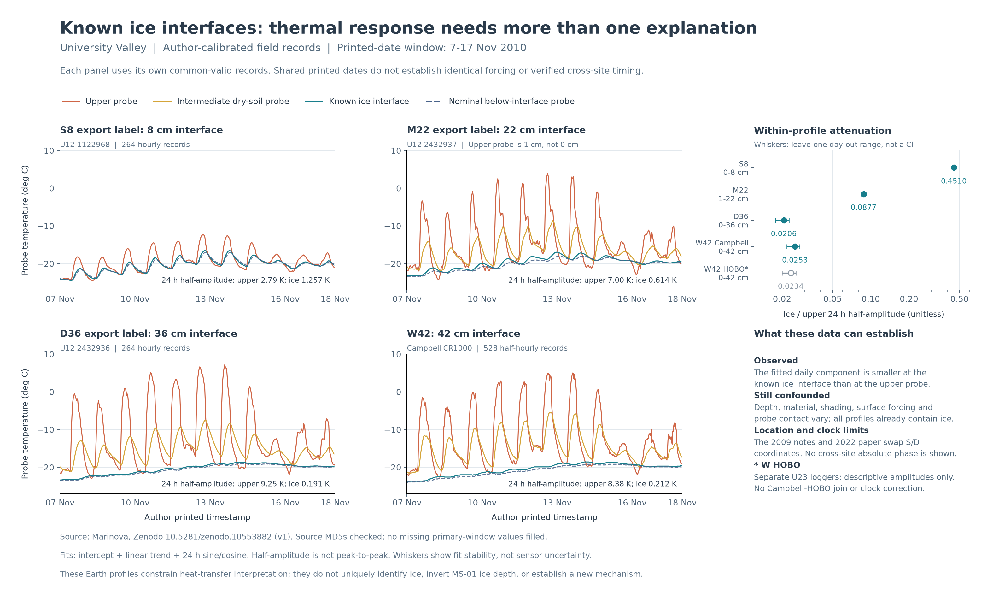

# MS-01：已知冰界面能增加哪些熱訊號判讀依據？

**University Valley 值得保留，但本輪資料不能把材料／覆土效應與冰界面效應唯一分離。** 四站在已知冰界面都有較小的日週期分量；這證明可用它們檢查分層熱傳模型、時間與感測器品質，以及模型是否對已知剖面給出合理響應。它不構成「只看熱訊號便能找到冰」的驗證。Beacon Valley 保留為塊狀冰及獨立材料量測的**補充對照**，並非完成此判斷的必要資料；本輪沒有取得其原始逐時序列，不能宣稱雙場址聯合驗證。

本輪延續 [原報告](report.md)，起始分支 SHA 為 `33f78ed986b0c39585dc4224b5f68bd6a7e9bed7`；Mars 數據仍以已核對的 `3cc8488577535e2fa4d146021fde51f8ff6cc667` 為基準。本輪未重新擷取 Mars 產品，也未增加 MS-01 冰量或冰深證據。資料取得／查核日期為 2026-11-15（Asia/Taipei）；所有新分析位於 `outputs/research/MS-01/thermal_followup/`。

## 1. 實際取得與共同期間

由 [Zenodo 固定 v1，DOI 10.5281/zenodo.10553882](https://zenodo.org/records/10553882) 實際下載四個短版 HOBO TXT（S、M、D、W）及兩份部署 DOCX，六檔逐一核對提供者 MD5、大小與本次 SHA-256。既有 W Campbell TXT 另重新核對相同固定版本的 MD5／SHA-256。完整檔名、URL、bytes、hash 與失敗／成功嘗試見 [source_manifest.json](../../../outputs/research/MS-01/thermal_followup/source_manifest.json)。這些是作者校準／篩選後的觀測匯出，並非未處理 logger bytes；CC0-1.0 為該資料集提供者所列權利。

先前檔案擷取曾遇 DNS、403 及 DOCX 二進位解碼錯誤；改由正常瀏覽器下載後驗證成功，沒有用錯誤回應補造數據。[search_log.csv](../../../outputs/research/MS-01/thermal_followup/search_log.csv) 記錄實際查詢與讀取。原始全檔可依固定 URL 重取；交付另保存可追到來源行／欄及原數字字串的 [分析期間資料](../../../outputs/research/MS-01/thermal_followup/primary_temperature_records.csv.gz)，不要求其他人有本機暫存檔才能讀懂結果。

共同名義日期固定為 **2010-11-07 00:00（含）至 2010-11-18 00:00（不含）**，即 11 個完整印刷日期日，沿用上一輪 W 分析窗口，於檢視 S／M／D 數值前寫入 [protocol.json](../../../outputs/research/MS-01/thermal_followup/protocol.json)。各站使用自身所有選定層位都有效的列；沒有補值、跨站逐時 join、改時區或挑選振幅最符合假設的日子。共享印刷日期不代表歷史時鐘已同步、受相同日照或同一表面邊界驅動。

| 匯出／logger 身分 | 全檔資料列與印刷日期範圍 | 間隔 | 主窗口共同有效列／預期列 | 本輪使用名義深度（cm） |
|---|---|---|---|---|
| S8；U12-008 1122968 | 8726；2009-12-10 00:00–2010-12-08 13:00 | 60 min | 264／264 | 0、8（界面）、15（界面下） |
| M22；U12-008 2432937 | 8751；2009-12-09 00:00–2010-12-08 14:00 | 60 min | 264／264 | **1**、12、22（界面）、27（界面下） |
| D36；U12-008 2432936 | 8728；2009-12-10 00:00–2010-12-08 15:00 | 60 min | 264／264 | 0、10、36（界面）、42（界面下） |
| W42 Campbell；CR1000 28046 | 17705；2009-12-04 19:30–2010-12-08 15:30 | 30 min | 528／528 | 0、10、42（界面）、49（界面下） |
| W42 HOBO；各深度獨立 U23 | 8625；2009-12-10 00:00–2010-12-04 08:00 | 60 min | 264／264 | 0、20、42（界面）；只作描述性補充 |

列數與時間為本次全檔計算；精確有效數、缺值與各欄最低溫旗標見 [comparison.json](../../../outputs/research/MS-01/thermal_followup/comparison.json) 的 `qa`。全檔 M、D 主選溫度各有 2 列缺值，W Campbell 各有 297 列缺值；主窗口選定溫度全部有效。數值存在不等於校準、接觸或工作溫區均合格。

## 2. 位置、探針與時間核對後的限制

**S／D 座標有未解來源衝突。** [Marinova et al. (2022), Methods](https://doi.org/10.1017/S0954102022000025) 與實讀的 2009 部署文件，把具名 S／D 的座標恰好對調，M 一致。以下是角分轉十進位的本次計算；額外小數不代表 GPS 精度。座標 datum 與定位誤差未知。部署文件位置以 `word/document.xml` 的 `w:p` 段落序號定位，**不是頁碼**。

| 匯出身分／名義冰界面 | 2022 論文具名座標（緯度、經度） | 2009 部署文件具名座標 | 處理方式 |
|---|---|---|---|
| S8／8 cm | −77.8597333, 160.7169833 | −77.8657667, 160.7286667 | 按 shal8 檔＋serial 1122968；位置版本並列 |
| M22／22 cm | −77.8628833, 160.7254500 | 同左 | 按 med22 檔＋serial 2432937 |
| D36／36 cm | −77.8657667, 160.7286667 | −77.8597333, 160.7169833 | 按 deep36 檔＋serial 2432936；位置版本並列 |
| W42／42 cm | −77.8621500, 160.7101000 | 兩份 HOBO 文件未獨立定位 W | 使用論文站錨點，未確認每支探針精確孔位 |

沒有作者勘誤／GPS 對照，不能決定哪份是筆誤，也不能依此把某條曲線配準到確定坡向或陰影。詳 [station_metadata.csv](../../../outputs/research/MS-01/thermal_followup/station_metadata.csv)。

- **通道不按深度排序。** M 的原始溫度欄順序是 12／27／1／22 cm；本輪上層是 1 cm，不能稱為地表 0 cm。S 的第四個 U12 通道為 Echo 電壓，非第四支溫度計。S 標頭 11 欄而 units／資料 10 欄（末段 `Shal_cm4_Ice,H` 分裂）；主用溫度第 3–5 欄不受影響，程式按位置並驗欄名，不盲用錯位 DictReader。
- **界面下深度保留名義值。** S 文件第三探針原記 4 cm、帶「應為 15 cm in ice」修註；M／D 文件記冰內斜孔長 9／11 cm，不是垂直深度，不能分別加到 22／36 得 31／47 cm 來覆寫匯出 27／42。主結果保留作者名義值，不聲稱重新測深。序號、欄序與文件段落見 [channel_metadata.csv](../../../outputs/research/MS-01/thermal_followup/channel_metadata.csv)。
- **時標保留原樣。** HOBO units 標 `GMT+13:00`。以 2009-01-01 加 decimal day 與印刷時間相減，S／M／D 差約 −0.048 至 +0.048 min（四位小數日的捨入量級）；W HOBO 則為 **59.952–60.048 min**。原因、哪欄正確及歷史對時未知，未擅自修正一小時。Campbell 使用其印刷 timestamp，未宣稱與 HOBO／太陽時對齊；W HOBO 每深度是獨立 U23，未解讀其層間相位。
- **維護紀錄不等於精確失效時間。** Dec2010 update 正文日期 2011-01-11，記 S 換電池後正常；M 岩下 T/RH 顯示 −94°C，M／D 四通道換電池後無法連電腦。沒有精確故障／恢復時間，因此不製造遮罩或假設後續長檔皆有效。本輪短檔窗口在該維護前。
- **誤差不能隨樣本數自動消失。** U1 Methods 列 Campbell 107／207 標稱 ±0.2°C；U23 在 −40 至 0°C 標稱 ±0.25°C、解析度 0.04°C；TMCx-HD 的 ±0.25°C、0.03°C 規格列於 20°C，不能冒稱已在南極全溫域驗證。U12 logger 標稱工作 −20 至 +70°C，作者曾於更低溫使用；TMC 探針量程 −40 至 +50°C。主窗口沒有選定值低於 −40°C，但這沒有消除 logger 低溫、系統 offset 或安裝誤差。表面薄土可能被風吹走，探針輻射／接觸偏差也可能改變上層曲線。[U1 Methods；D09 段26–80；D10 段5–7]

## 3. 關鍵比較圖與計算



圖中時序是作者處理後的**實測溫度**；振幅、比值與敏感度為**本次計算**。每層在自身站共同有效列上擬合：

\[
T(t)=a+b(t-\bar t)+c\sin(2\pi t/24)+d\cos(2\pi t/24),\qquad A_{24}=\sqrt{c^2+d^2}.
\]

`t` 單位為自窗口起點的小時，`A24` 為半振幅（K），不是日最高減最低，也不是熱慣量。表中比值為界面 `A24`／上層 `A24`，無單位。以留一個印刷日期日重擬合的最小／最大比值顯示窗口敏感度，**不是信賴區間或感測器誤差棒**；另加 12 h nuisance harmonic 檢查 24 h 分量。完整 18 通道數字見 [amplitudes.csv](../../../outputs/research/MS-01/thermal_followup/amplitudes.csv)，程式見 [analyze.py](../../../outputs/research/MS-01/thermal_followup/analyze.py)。

| 匯出身分 | 上層 A24（K） | 中間層 A24（K） | 界面 A24（K） | 界面下 A24（K） | 界面／上層 | 留一日比值範圍 | 界面殘差 RMSE（K） |
|---|---:|---:|---:|---:|---:|---:|---:|
| S8 | 2.7883 | 未用同 U12 中層 | 1.25745 | 1.02047 | 0.45097 | 0.44709–0.45645 | 1.15357 |
| M22（上層 1 cm） | 6.9957 | 3.01892（12 cm） | 0.61382 | 0.35926 | 0.08774 | 0.08449–0.09094 | 1.09508 |
| D36 | 9.2508 | 2.98475（10 cm） | 0.19089 | 0.15576 | 0.02063 | 0.01775–0.02263 | 0.70193 |
| W42 Campbell | 8.3783 | 3.88519（10 cm） | 0.21165 | 0.12693 | 0.02526 | 0.02172–0.02759 | 0.74156 |
| W42 HOBO（分開的 U23） | 7.6105 | 1.70926（20 cm） | 0.17818 | 無選定通道 | 0.02341* | 0.02001–0.02564* | 0.69269 |

\* W HOBO 是跨 logger 的描述性振幅比；未證明對時，不作相位或受控因果解釋，也不與 Campbell 合併／平均。各剖面代表個別探針附近公分尺度，探針接觸體積／代表半徑未知，不代表整谷或 MS-01 像元。

主要觀測是四個主剖面向下衰減，**不是冰深與衰減的嚴格校準曲線**。D36 比值比 W42 Campbell 小，留一日範圍也重疊；其覆土厚度、材料、日照／陰影、風及表面探針條件並未固定。把各自上層振幅正規化，只除去一個振幅尺度，未控制非正弦能量輸入、垂向物性、季節背景或感測器偏差。

D／W 界面 24 h 分量小於其模型殘差 RMSE，表示 11 日曲線仍有較慢變化或其他未描述分量；**RMSE 不是儀器噪聲估計，也不能據此說週期訊號不存在**。相同 logger 的相對相位只作描述，主分析另保存 `[-12,12)` 取模值；深層負值可能相當於超過半日的延遲，不能直接稱熱波提前，更未逆推熱擴散率或冰深。

## 4. 觀測—可能解釋—不能排除的解釋

完整、可機讀的八列判讀帳見 [interpretation_table.csv](../../../outputs/research/MS-01/thermal_followup/interpretation_table.csv)。下表是本輪結論的核心，不以單一機制填滿未知。

| 觀測 | 可能解釋 | 不能排除的解釋／限制 | 對 MS-01 增加的依據 |
|---|---|---|---|
| 同 logger 深層 A24 較小，冰界面在部署時已知 | 覆土與下層物性共同傳遞熱波 | 均質無冰材料也會衰減；缺同材料、同 forcing 無冰控制 | 可檢查已知分層模型；無法驗證盲判冰的特異性 |
| S 上層 A24 2.79 K，D 為 9.25 K | 淺冰導熱與覆土隔熱可能有影響 | 局部日照／陰影、材料、探針暴露及接觸亦能改變訊號 | 表面邊界與材料必須獨立約束，不能只按地表振幅選機制 |
| D36 與 W42 比值未按深度嚴格排序，敏感度範圍重疊 | 多種熱性質與邊界條件有共同作用 | 站間非受控，且上層深度／儀器不同 | 不建立地球比值直接換 MS-01 冰深的公式 |
| D／W 界面分量約 0.19／0.21 K，殘差較大 | 深處日週期較弱、較慢變化仍存在 | 系統誤差、非平穩性、其他頻率；RMSE 非噪聲 | 要報多時相與檢出限制，不把小振幅當作地下冰已被盲測證實 |
| W HOBO 時標兩欄差約 1 h；S／D 座標版本對調 | 匯出慣例／來源版本差異 | 真實對時與確切位置未解 | 空間配準、坡向與相位判讀須停在可證範圍 |
| Beacon 研究有塊狀冰及土樣密度／比熱 | 可比較界面型態與材料約束 | k 多為推估，本輪無其原始逐時資料 | 補充結構／物性對照；不是新的獨立冰偵測證明 |

為何多層溫度仍不足？在均質傳導、指定溫度邊界下，`κ=k/(ρCp)` 控制溫度傳遞。令 `k′=λk`、`(ρCp)′=λρCp`，則 κ 不變、同邊界的 T(z,t) 可相同，而 `I′=λI`（`I=√(kρCp)`）。深度與 κ 亦透過 `z/√κ` 出現耦合。這是**本輪對標準方程的符號辨識說明**，不是新增現地結果、真實無冰材料反例、或 MS-01 模型解算；若採能量／通量邊界，還必須獨立約束該邊界。它說明不能由溫度傳遞便宣稱測得唯一材料、熱慣量或冰含量。[U1 Appendix Eq12–20；本輪推論]

## 5. Marinova 已回答什麼，本輪具體新增什麼？

本輪讀過 U1 出版社全文的 Methods／Meteorological measurements、Thermal diffusivity、Results／Model validation、Discussion、Appendix Methods 1–3（Eq12–20）；兩 DOCX 讀完整 `word/document.xml`；Beacon 讀 B1 §2–5、Tables1–2／Fig2。實讀範圍與來源 URL 見 [sources.json](../../../outputs/research/MS-01/thermal_followup/sources.json)，差異見 [prior_work_delta.csv](../../../outputs/research/MS-01/thermal_followup/prior_work_delta.csv)。未做 Scopus／WoS 系統綜述，不宣稱全球新穎。

| 面向 | 既有研究已做 | 本輪工作與貢獻界線 |
|---|---|---|
| 振幅／相位、熱擴散率 | U1 Appendix Method2 已以年度正弦振幅／相位估 κ；亦比較 Methods1／3 | 固定 11 日、24 h 分量、同 logger 比值及留一日敏感度的**描述性重算／應用**；不是新方法，也未完整重現年度 κ 分析 |
| 覆土與冰深、能量收支 | U1 已做冰深、風、輻射與物性敏感度，且指出均質年諧波法在分層／變物性條件下的問題 | 未重跑三年能量模型；不把覆土隔熱／淺冰散熱當新物理發現 |
| 材料辨識限制 | U1 明言缺本站獨立 k、ρ、Cp；冰膠結層亦借前人值 | 將此限制連到 MS-01 的 TES／SWIM 判讀，列出可支持與仍不可排除的機制 |
| 資料溯源 | 原作者已提供部署、維護、校準／篩選序列 | 新增此次交付的 serial／channel／雙版座標對照、固定窗口精確來源行、獨立數值覆核；未聲稱首次發現來源錯誤 |
| Beacon 模型 | [Liu et al.2018](https://doi.org/10.1029/2017JF004535) 已分析埋藏塊狀冰、材料與導熱數值模型 | 只界定其補充用途；無新雙谷驗證或模型性能結果 |

本輪相對前一版 W 單站具體增加：S／M／D 的共同有效資料、完整多層比值及穩定性；本輪資料不足以建立四站的單調冰深標定；揭露此次配準不能忽略的 S／D 座標版本衝突與 W 時標欄位差；並將這些限制轉成 MS-01 的證據判準。這是**針對目標的可追溯判讀分析**，不是「University Valley 從未被用作火星類比」。

## 6. 候選處置與 MS-01 的研究價值

**MS-01-E01 University Valley：保留，限定為已知冰膠結界面的分層熱傳／模型可辨識性案例。** 可驗證模型能否在觀測邊界與名義深度下描述上層、覆土、界面與界面下的響應，並檢查資料處理會否把錯通道、錯時間或表面偏差誤當冰訊號。不能由已知有冰資料推算冰偵測成功率、排除無冰材料、或推得 MS-01 冰深。精確 S／D 孔位與跨 logger 對時仍待證據；本輪不作其陰影地圖或跨站絕對相位歸因。

**MS-01-E02 Beacon Valley：保留為可選的文獻級補充，原始資料比較待補證據。** B1 §2 記約 0.30 m 乾覆土下塊狀冰，1999–2011 逐時剖面；§3.1–3.2 有土樣實測密度及量熱比熱，而導熱係數主要用半經驗式推估。它與 UV 的冰膠結介質在界面結構及材料約束上不同，能幫檢查「把冰視作塊狀或冰膠結」的模型假設；這類對照在該問題上有用，**Beacon 這個特定場址不是本輪結論不可替代的必要條件**。本輪無原始序列，不給其新振幅、不與 UV 算相似百分比，也不稱聯合驗證完成。

對 MS-01，本輪增加的是**防止過度判讀的依據與可檢驗條件**：既有 TES 熱慣量產品是像元材料／熱性質的產品推估，SWIM 是多資料一致性而非含冰量或機率；兩者不能與地球公分剖面相減或直接做因果分解。MCS 粗網格不是 MS-01 當地實測。本輪沒有取得 Mars 的已知冰界面真值，故「覆土／材料」與「地下冰」兩類解釋仍均可保留。

下一個可執行的驗證應針對缺少的約束，而非再以同類熱曲線重複宣稱有冰：在可取得原始資料及位置對照的前提下，以**獨立材料 k／ρCp、同址表面能量與陰影、獨立冰界面位置**約束分層模型，再用未參與設定的深度／時段檢驗。欲驗冰偵測特異性，另需同材料、相近 forcing 的無冰對照或已知真值的盲測；UV 四站本身未提供該控制。對 MS-01 則需局部材料／岩塊、匹配季節時刻的多時相地表觀測及獨立冰約束，才能逐步縮小機制集合。以上是尚未執行的驗證條件，**不是本輪已完成或要繼續擴張的研究任務**。

## 7. 重現與驗收

在專案根目錄，以含 numpy／matplotlib 的 Python 執行；`<raw-dir>` 為自行指定的輸入暫存目錄，下載器不覆寫 checksum 不同的既有檔：

```sh
python outputs/research/MS-01/thermal_followup/fetch_inputs.py --raw-dir <raw-dir>
python outputs/research/MS-01/thermal_followup/extract_deployment.py --raw-dir <raw-dir>
python outputs/research/MS-01/thermal_followup/analyze.py --raw-dir <raw-dir>
python outputs/research/MS-01/thermal_followup/independent_check.py --raw-dir <raw-dir>
python outputs/research/MS-01/thermal_followup/plot_comparison.py
python outputs/research/MS-01/thermal_followup/validate.py --raw-dir <raw-dir>
```

網路若拒絕腳本下載，改用來源頁的正常下載按鈕保留原檔，再重跑 checksum。獨立覆核以另一套逐欄讀取／OLS 程式核四 HOBO；W Campbell 另與上一輪已交付四通道值逐一比對。驗收核來源 bytes/hash、共同列數、18 通道值、5808 個來源行欄數字、圖／報告路徑與輸出 manifest；這是交付一致性驗證，不是物理真值或新穎性保證。全檔、取用欄位、期間、深度與代表尺度的限制均隨資料保存。
