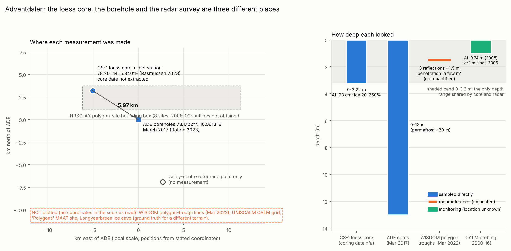
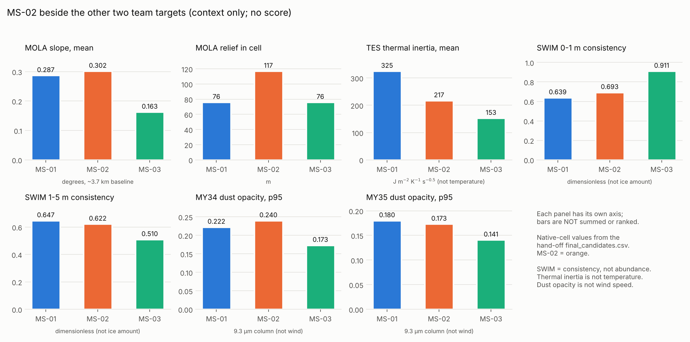
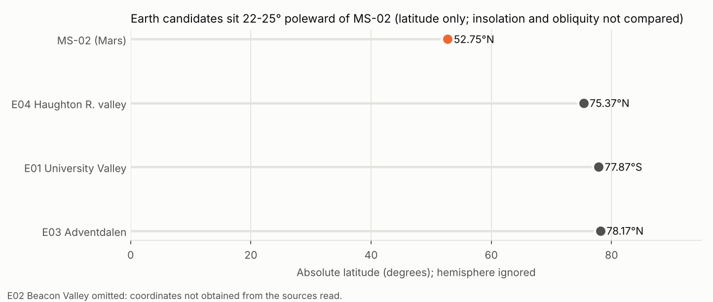

# MS-02 地球類比場址研究報告

Team zasa｜NASA Space Apps 2026｜研究日期：2026-11-14（Asia/Taipei）；第四輪 Adventdalen 證據查核：2026-11-15
火星點：**MS-02，52.75°N、168.25°E**（名義範圍 52.50–53.00°N、168.00–168.50°E，約 29.6 × 17.9 km 的分析單元，不是著陸橢圓、鑽孔或實地測區）

## 1. 結論摘要

- 找到 4 個有文獻依據的地球候選：**保留 1 個（E01）、降為一般方法參照 1 個（E03，第四輪查核後由「保留」降級，見 §8B）、待補證據 2 個（E02、E04）**，沒有排除。
- 沒有任何一個地球場址能「代表」MS-02。它們各自只能測試一個具體過程：
  - **E01 University Valley（南極）**：乾燥覆土下的冰膠結層，冰面深度、覆土與季節熱背景的耦合。
  - **E03 Adventdalen（斯瓦巴）**：風成粉砂覆土與同生永凍冰（僅 CS-1 岩芯一處有直接量測）；多邊形溝槽的雷達反射只有作者結論，無獨立冰真值；岩芯、鑽孔、雷達三組證據**不在同一地點**。
  - E02 Beacon Valley、E04 Haughton／Devon Island 是補充對照，目前證據不足以保留。
- 在我搜尋過的平台與詞彙內，**未找到**「MS-02 這個點＋這幾個地球場址＋相同用途」的先例（見 §6）。這不等於從未有人研究過。
- 本報告不計算任何「最像火星百分比」，也不為各面向設權重。

## 2. 資料基準與核對

| 項目 | 結果 |
|---|---|
| 研究分支 | `research/ms-02-earth-analogs` |
| 基準 commit | `f7076c9fdc77e00244ed5d6863aad2bf78cfa28f`（`handoff/verified-data-20261114`，2026-11-14 23:41 +0800，「Add verified full workbook and complete Mars screening data」） |
| 開始時 origin/main | `3cc8488577535e2fa4d146021fde51f8ff6cc667`（**不含**兩個大檔） |
| 為何選交接分支 | 未指定共同 SHA；只有該分支同時含兩個大檔，與 main 的差異就是這兩個檔案 |
| 整合 Excel | `outputs/consolidated/NASA_Space_Apps_2026_All_Data.xlsx`，23,035,176 B，zip 完整性通過，openpyxl 可列出 33 個工作表（sha256 見 manifest） |
| 完整篩選結果 | `outputs/research/mars_reselection_20261114/screened_pool.csv.gz`，7,702,846 B，gzip 通過，58,238 列 × 54 欄，可找到 MS-02 該格 |
| MS-02 數值交叉核對 | `final_candidates.csv`、`screened_pool.csv.gz`、`candidate_native_evidence.json` 三份交接檔 14 項一致性檢查全數通過（`verification.json`） |
| 缺檔 | `docs/TEAM_START.md`、`scripts/restore_team_data.py` 在 main 與交接分支都不存在（交接分支已直接提交資料，故沒有還原步驟可執行） |
| 無法做到 | 沙箱連原始 PDS／SWIM 檔案回 HTTP 403，**未從原始網格重算**，只做三份交接檔的互相核對 |

歷史 Excel 的 I-01／I-02、Elephant Head 與舊地球配對只當背景，本報告所有 MS-02 數值都來自上述重新核對的檔案。

## 3. MS-02 已核實特徵與限制

| 面向 | 核對值（原生格或最近產品格） | 能說到哪裡／不能說 |
|---|---|---|
| 地形 | 平均高程 −3898.7 m（−3956～−3839）相對 areoid；平均坡度 0.302°（中位 0.207°，最大 0.925°），約 3.7 km 基線；高差 117 m；64/64 格有效 | 區域尺度。**不是**局部通行安全；MEGDR 含無軌跡處插值，未取得雷射密度遮罩 |
| 熱性質 | TES 夜間熱慣量平均 217.27（中位 213，177–276）J m⁻² K⁻¹ s⁻⁰·⁵；93/100 格有效，7 格插值被排除 | **不是**溫度或硬度；PDS 標籤無觀測期間（2007 為產品建立年） |
| 溫度背景 | MCS 03／15 LTST 有值中位 171.27／246.31 K，配對差 66.83 K；MY29–36，75/288 共同分箱 | 5° 分格中心 (55.0°N,170.0°E) 距 MS-02 約 **146.7 km**（本次計算）；經校時，缺 QA 與不確定度；**不是**年均溫，不能與地球 MAAT 直接比 |
| 水／冰 | SWIM 0–1 m 平均 0.693（0.665–0.784）；1–5 m 平均 0.622（中位 0.5，最大 1.0）；皆 100/100 格有效 | 提供者說明這是與冰「一致」的程度，**不是含冰量或機率**；兩深度共用輸入（地貌、雷達），不是獨立互證 |
| 大氣／沙塵 | MY34：均值 0.125、p95 0.240、最大 0.453（Ls 327.5°）；MY35：0.110／0.173／0.315（Ls 41.9°）；9.3 µm 吸收柱光學厚度 | 3° 格 (52.5°N,168.0°E)，距 MS-02 約 17.3 km；**不是**風速、沉積率或氣壓 |

**區域歸屬**：MS-02 落在 Cebrenia 四邊形（MC-7，30–65°N、120–180°E）內；該圖幅含部分 Utopia Planitia、部分 Arcadia Planitia 與 Phlegra Montes。USGS IMAP 1140（Elston 1979）摘要說圖幅大部分為環極平原，受風、冰川與冰緣作用改造。Morgan 等 2021 摘要指出 Arcadia 平原與 Deuteronilus Mensae 在 SWIM 一致性圖上條件最符合；交接報告則說 Phlegra 大區已有研究。因為圖幅只含**部分** Arcadia，我**沒有**證據把 MS-02 寫成 Arcadia，也沒有讀到 MS-02 所在的正式地質單元（需要讀圖版）。

## 4. 地球候選

| ID | 場址 | 座標 | 研究範圍與邊界依據 | 處置 |
|---|---|---|---|---|
| MS-02-E01 | University Valley，McMurdo Dry Valleys（南極） | 77.87°S、160.75°E，約 1700 m | 觀測站群（1661–1697 m）所在谷底；邊界依 Marinova 2022 p.145–146；**未取得**精確範圍 | **保留** |
| MS-02-E02 | Beacon Valley（南極） | 座標未取得 | 僅讀 4 篇摘要，範圍未定 | **待補證據** |
| MS-02-E03 | Adventdalen，Svalbard | ADE 階地點 78.1722°N、16.0613°E，海拔 23 m | 谷底與階地（谷長約 40 km、寬至約 3 km，Hauber 2011 p.113）；PANGAEA 多邊形資料集（Ulrich 等 2020）另有 8 個場址的範圍框 | **降為一般方法參照**（見 §8B） |
| MS-02-E04 | Haughton River Valley，Devon Island，Nunavut | 75.37°N、89.53°W（Andres Fig. 1.8） | 9 個 LiDAR 格（Table 3.1，UTM 16N 換算為 75.359–75.394°N、89.510–89.655°W），約 3.9 × 4.0 km（本次計算）；河谷寬約 1.5 km | **待補證據** |

E04 有兩個不同的錨點，並非矛盾：p.6 的 75°22′N、89°41′W 是 23 km 撞擊構造中心，Fig. 1.8 與 LiDAR 格是河谷研究區，兩者相距約 **4.3 km**（本次計算）。本報告以河谷研究區為 E04 的位置。

## 5. 四面向比較

**可比性說明**：Earth 側多為實測的空氣或地溫（°C）；MS-02 側為產品推估（MCS 地表亮溫中位、TES 熱慣量、SWIM 一致性、光學厚度）。不同量、不同深度與時間尺度，**不能直接相減或排名**，下表只說「相似處、差異、研究意義」。

| 面向 | MS-02 | E01 University Valley | E03 Adventdalen | 研究意義與限制 |
|---|---|---|---|---|
| 地形 | 區域坡度 0.30°、高差 117 m（3.7 km 尺度） | 谷底高程約 1677–1697 m；坡度與高差**未知** | 谷長 ~40 km、寬 ≤ 3 km；多邊形直徑 10–20 m（Mars 例 5–10 m，Hauber Fig. 4） | 尺度不同：Mars 是 km 尺度格，Earth 是 m 尺度地貌；只能問「哪種局部地貌值得先看」，不能比坡度數字 |
| 溫度／熱性質 | 熱慣量 217；MCS 03／15 LTST 中位 171／246 K | 空氣 MAAT −23.4 °C（249.75 K），42 cm 冰面處地溫 −24.1 °C；導熱係數乾土 0.6 ± 0.1、冰膠結 2.5 ± 0.5 W m⁻¹ K⁻¹（引用值，Marinova 附錄 p.165）；**熱慣量不能導出**（缺密度與熱容） | MAAT −5.8 °C（267.35 K，Rotem 2023）；Svalbard Airport −6.3 °C（1912–1993）；**熱慣量未知** | MAAT 與 MCS 中位不同量；意義在於 E01 提供「冰面上下多深度溫度」可用來檢驗覆土如何改變熱訊號 |
| 水／冰 | SWIM 0.69／0.62（一致性） | 冰膠結層頂 42 cm（站點），沿谷底約 0 至 >1 m；活動層約 15 cm | 活動層 60–100 cm（Rotem 引用）；UNISCALM 摘要稱 2006 年起活動層 ≥1 m（前 6 年 <1 m，2005 年最小 74 cm），兩者不同期，未調和；多邊形溝槽約 1.5 m 處 GPR 冰狀反射（ε≈3.2，活動層 ε≥7，2022 年 3 月） | E01 是**乾燥覆土下的冰膠結**，E03 是**含水的活動層下的冰**；MS-02 的冰深與類型**未知**，不能借用 |
| 大氣／沙塵 | CDOD MY34 p95 0.240、MY35 0.173 | 風速計 1.08 m 已安裝但文中**未找到風速值**；感測器曾被薄土覆蓋，風可能移除；McKay 2009 摘要指高原風吹雪使冰膠結層深度出現梯度 | CS-1 岩芯（過去約 3000 年，OSL）：摘要稱最高 0.35 cm/yr，內文為 c. 750–900 年前一段 >0.3 cm/yr、約 2900 g m⁻² yr⁻¹（峰值期、作者稱「粗略估計」），其餘多為 0.05–0.25 cm/yr（Rasmussen 2023 Sec. 5.4） | 地球的堆積速率、粉塵來源與火星光學厚度**不可換算**；E03 提供「覆土如何累積並與永凍層一起生長」的物理過程 |

### 各候選的差異摘要

- **E01 vs MS-02**：緯度（77.9°S 對 52.75°N）、氣壓、日照、大氣與冰來源都不同；優點是有冰面以上與以下的實測溫度（10／42／49 cm，2010–2013）與能量平衡模型。
- **E03 vs MS-02**：Adventdalen 比 E01 溫暖潮濕，具薄活動層與厚粉砂堆積；用途是檢驗**多邊形＋覆土＋雷達**，不是溫度。
- **E02**：只有 4 篇摘要。Heldmann 2013 稱冰在 10–60 cm；Kowalewski 等 2006 稱 Beacon 谷中部冰上覆有 40–80 cm 的昇華堆積物（sublimation till），2004-11-18 至 12-29 冰的淨損失約 0.017 mm；McKay 2009 推論谷底雪再現期 >10 年；Bannister 2007（學士論文）稱厚冰 >100 m。前兩者深度範圍不同，**未調和**；座標仍未取得。
- **E04**：有實測融化深度（2019 年 7 月：0.52–0.67 m）、多邊形／條紋直徑 5–31 m、East Camp Polygons 平均面積 984 ± 452 m²；**沒有** Haughton 的含冰量或地溫序列；GPR／震測只給出永凍層頂深度約 0.6–0.9 m（Nieto & Stewart 2003；CSEG 文章另載 Vp 約 260／3100 m/s 與未說明來源的「−17 °C」，不採用為場址地溫）。論文裡 10–20% 含冰量是加拿大高北極一般範圍，Strand Fiord 的 43.28 m³ 冰楔體積也是別的場址，兩者都不能用在 Haughton。

## 6. 可檢驗問題（研究假設，不是結論）

- **H1（覆土與熱訊號）**：冰面以上有乾燥覆土時，冰面深度是否改變季節與日溫度振幅，改變量在 3 km 級熱慣量或 5° MCS 尺度下能否分辨？（E01 的多深度溫度可測；不能外推到 MS-02。）
- **H2（風沙覆土）**：風成粉砂的累積是否可能使覆土厚度超出雷達或熱探測能分辨的範圍？（E03 的 loess 岩芯與 GPR 可測；Earth 速率不可轉為 Mars 沉積率。）
- **H3（多邊形溝槽）**：多邊形溝槽是否是探地雷達偵測冰狀體的較有利位置？（E03 有 1.5 m 反射的作者結論，僅摘要層級，且摘要未載多邊形溝槽的獨立冰真值；見 §8B。）
- **H4（一致性評分行為）**：SWIM 式多資料集一致性在已知含冰的地球點與無冰對照點是否給出可分辨差異？（需要在地球點建立類似輸入，尚未做。）
- MS-02 側的對應問題：高 MY34 沙塵 p95（0.240，三點中最高）、較大高差（117 m）與 SWIM 兩深度結果，是否影響在 MS-02 取得局部觀測時的冰判讀？這只是比較問題，現有資料不能回答。

## 7. 先例檢索與差異

**檢索平台**：WebSearch（一般模式）與 WebFetch，日期 2026-11-14（S01–S52）與 2026-11-15（S53–S65，Adventdalen 查核）；完整字串與讀取範圍見 `outputs/research/MS-02/search_log.csv`。多數結果只讀到標題或摘要，已在 `prior_work.csv` 註明；只有 Hauber 2011、Marinova 2022、Andres 2020 、Nieto & Stewart 2003（CREWES 報告），以及第四輪的 Rasmussen 2023 與 Rotem 2023（各讀前 100,000 字元，萃取文字）讀到內文。

| 先例 | 場址 | 分類 | 與本次差異 |
|---|---|---|---|
| Heldmann 等 2013（PSS 85:53）；Marinova 等 2022（Antarct. Sci. 34:144） | E01／E02 | **部分重疊** | 同場址、火星淺層冰用途；比較對象是 Phoenix（68.2°N）。問題、範圍與資料與 MS-02（52.75°N、覆土＋沙塵＋季節）不同 |
| McKay 2009（Antarct. Sci. 21:89） | E01／E02 | **部分重疊** | 雪再現期決定冰膠結層深度，提出火星可能適用；只讀摘要 |
| Kowalewski 等 2006（Antarct. Sci. 18:421） | E02 | 用途不同 | 摘要未談火星；冰的昇華速率 |
| Bannister 2007（學士論文，Zenodo） | E02 | 部分重疊（證據層級低） | 只讀摘要；地球物理剖面 |
| Hauber 等 2011（Geol. Soc. Spec. Publ. 356:111） | E03 | **部分重疊** | Adventdalen 對應火星中緯度（30–60°）地貌；未提 Arcadia；方法為形貌比較；作者說情境不會準確代表火星 |
| Brighi 等 2025（EPSC-DPS 摘要） | E03 | 部分重疊（方法）／用途不同 | 同谷名的 GPR（無座標，不能視為與 CS-1 或 ADE 同址）；目的是 ExoMars WISDOM 在 Oxia Planum 的驗證；冰洞另有 3D 真值（Longyearbreen，不同地形） |
| Rasmussen 等 2023（QSR） | E03 | 用途不同 | 讀到內文（0–100,000／107,876 字元）；無火星問題；CS-1 岩芯含實測含冰量與 OSL 堆積速率 |
| Andres 2020（碩論） | E04 | **部分重疊** | 同場址（Haughton 河谷），用於行星地貌學；火星討論指向 Oxia Planum／Jezero，未提 Arcadia；無 Haughton 含冰量或 GPR |
| Hibbard（博論，Arcadia＋加拿大高北極） | E04 | **證據不足** | 與 Arcadia 類型區域最接近，但摘要頁無座標與場址名，無法確認是否與 E04 同址 |
| Morgan 等 2021（Nat. Astron. 5:230）；Elston 1979（USGS IMAP 1140） | MS-02 側 | 用途不同 | 前者定義 SWIM 一致性圖，後者為區域地質圖；皆非地球類比 |
| 「MS-02 專屬」先例 | E01–E04 | **證據不足** | 搜尋範圍內未找到；**不能寫成從未研究** |

本次研究的新增處（需待同行確認）：把「覆土＋季節熱背景＋風沙＋冰探查」整合成針對**單一火星點**的可檢驗問題清單，並對每個地球候選明確列出能測與不能外推之處。

## 8. 處置理由、能驗證與不能外推

| 候選 | 處置 | 理由 | 能驗證 | 不能外推 | 下一步 |
|---|---|---|---|---|---|
| E01 | 保留 | 多深度實測溫度橫跨冰面；有能量平衡模型；有 a_w＞0.6 且 T＞−18 °C 約 2560 h/年（約 29%）的數值 | H1：覆土與冰面深度對熱訊號的影響 | 42 cm 冰面深度、溫度、水活度不可套到 MS-02 | 取 Table II／Fig. 6 原始序列；找土壤熱性質與風速 |
| E02 | 待補證據 | 4 篇摘要有數值（覆土 40–80 cm、昇華約 0.017 mm／6 週），但無座標、溫度表與全文；兩個冰深範圍未調和；Bannister 100 m 未核對 | 塊狀冰與冰膠結的對照；覆土下冰的昇華對溫濕度的敏感性（暫定） | 厚冰深度、昇華量 | 讀 Kowalewski 2006、McKay 2009 全文取座標；讀 Marchant & Head 2007（未讀） |
| E03 | 降為一般方法參照 | 三組證據不同址（CS-1 與 ADE 相距 5.97 km；WISDOM 多邊形測線無座標）；雷達反射無獨立冰真值；僅 CS-1 有實測含冰量與覆土堆積 | H2 的地球側過程（覆土堆積與同生冰），不含雷達偵測 | Loess 速率、活動層深度、ε 值、沙塵光學厚度均不可轉成 MS-02 覆土厚度、堆積率或介電值 | 取得 Brighi 等 WISDOM 全文（測線座標、真值、ε 來源）；確認 CS-1 與多邊形場是否同階地；取 PANGAEA 多邊形資料與 SESS 2018 鑽孔序列（本環境下載被拒），需在可連線環境取得 |
| E04 | 待補證據 | 有融化深度、多邊形幾何與 GPR／震測的永凍層頂深度（約 0.6–0.9 m），但沒有 Haughton 含冰量或地溫序列 | 圖案化地形幾何與活動層厚度（LiDAR 尺度） | 高北極一般含冰量；7 月單次融化深度 | 找 Haughton 地溫／鑽孔與含冰量資料；讀 Hibbard 本文確認是否含 Devon／Haughton |

## 8B. Adventdalen 三組證據查核（第四輪，2026-11-15）

**問題**：Adventdalen 能否支持 MS-02 的「風成覆土下探冰」研究，還是把不同測區的粉砂、活動層與雷達結果拼在一起？

**處置**：**降為一般方法參照**。三組證據各自成立，但**不在同一個地點**，也沒有任何一處同時具備「有年代的風成覆土＋量測到的冰＋雷達偵測」。只有 CS-1 岩芯這一個子證據保留為「覆土堆積與同生永凍冰」的地球側過程類比；「雷達在覆土下偵冰」這一環判定為**證據不足**。

圖 3 左：依文獻所載座標畫出的位置（沒有座標的測區**不畫**，列在圖下方）；右：各組實際看的深度。幾何資料見 `footprint.csv`，距離為本次計算（`verification.json`）。

### 三組證據的實際範圍

| 組 | 來源 | 座標與範圍 | 年份 | 深度 | 量到什麼 | 獨立真值 |
|---|---|---|---|---|---|---|
| A 風成沉積／岩芯 | Rasmussen 2023 | CS-1，78.201°N 15.840°E（階地平坦植被面）；岩芯 310／314.5／322 cm，剖面約 180 cm（岩芯東北約 20 m） | 取芯日期未萃取（紀錄涵蓋約 3000 年） | 0–3.22 m | 136 個 OSL 年代、2 cm 間隔重量含冰量、粒徑、冷凍構造 | 有：含冰量與冷凍構造為岩芯實測 |
| B 活動層／鑽孔 | Rotem 2023（活動層另見 Rasmussen、UNISCALM） | ADE，78.1722°N 16.0613°E，兩孔相距 0.5 m（13 m、9 m）；與 Gilbert 等 2018 同一 S1 位置。「Polygons」站與 CALM 格無座標 | 2017 年 3 月（鑽孔）；CALM 2000–2016 | 鑽孔 0–13 m；活動層 0–約 1 m | 孔隙水離子化學與凍結模型；活動層探測 | 鑽孔本身即資料；無雷達 |
| C WISDOM 雷達 | Brighi 等 2025（摘要）；2026 摘要 | 「Adventdalen 谷」，無座標；4 條平行測線跨 2 條多邊形溝槽。冰洞在 Longyearbreen（距 Longyearbyen 西南約 5 km） | 2022 年 3 月 | 反射約 1.5 m；穿透「數公尺」 | 0.5–3 GHz 極化雷達圖＋FDTD 模擬 | 多邊形溝槽：摘要**未載**；冰洞：有 3D 洞穴測量，但屬不同地形 |

CS-1 與 ADE 相距 **5.97 km**；ADE 位於 PANGAEA 多邊形場址範圍框南緣以南約 1.1 km（本次計算）；雷達測線與 CALM 格無座標，無法計算距離。同一個谷名不能當成同址。

### 主張—直接證據—替代解釋

| 主張 | 提出者 | 直接證據（地點／年／深度） | 替代解釋或限制 | 狀態 |
|---|---|---|---|---|
| C1 風成粉砂覆土與同生冰一起生長 | 作者（Rasmussen） | CS-1 岩芯：含冰量 20–50%（至約 155 cm）、60–80%（155–188 cm）、底部達 250%；主要為同生冷凍構造；含冰量往上遞減 | 作者：約 275–295 cm 以下可能有後生冰／擾動造成年代倒置；10–55 cm 有再搬運；高含冰量影響 OSL 劑量 | **支持（僅 CS-1）** |
| C2 堆積速率 0.35 cm/yr、約 2900 g m⁻² yr⁻¹ | 作者（摘要／結論） | 內文：c. 750–900 年前 >0.3 cm/yr、約 2900；1900–2450 年前約 0.25／2000；活動層以下多 ≤0.15 | 摘要的 0.35 在讀到的內文找不到；密度來自 7 個樣品，作者稱「粗略估計」；來源是附近河灘，風與冰川河沉積供給兩種解釋並存 | **部分支持（峰值期，非長期平均）** |
| C3 活動層 60–100 cm | Rotem（引用） | CS-1 為 98 cm（Rasmussen，稱與 CALM 相符）；UNISCALM 前 6 年 <1 m（2005 年最小 74 cm），2006 年起 ≥1 m | 三者不同地點與年份；Rotem 的 60–100 cm 是「通常」範圍的引用，不是 ADE 實測 | **數量級一致，非同址同年** |
| C4 ADE 鑽孔刻畫谷底永凍層 | 作者（Rotem） | 同生 1.0–5.5 m；後生 5.5 m 以下；氯離子界面 9–11 m | 化學訊號可能來自沉積物溶解或離子交換；無雷達、無介電常數；鹽度界面比 1.5 m 反射深得多 | **支持（ADE 結構）；與雷達無關** |
| C5 多邊形溝槽約 1.5 m 反射是冰楔 | 作者（Brighi） | 3 個反射約 1.5 m；FDTD 模擬顯示中間反射「無冰楔無法解釋」 | 摘要自述：雪—溝槽介面反射在陡坡消失；洞內回波可能為多重反射。**本隊假設（非作者）**：含冰量隨深度的介電對比（CS-1 含冰量 20–250%）、凍／融或岩性界面、天線—地面耦合（Plettemeier 2025）；CPR 高值不必然是水冰（Harrar 2025，模擬） | **作者結論；無獨立冰真值** |
| C6 ε=3.2（冰）與 ε≥7（活動層）為量測值 | 本隊待查 | 摘要把它們列為模型輸入，未說明如何取得 | 完整論文才能判斷是量測、校準或假設 | **未證實** |
| C7 核心、鑽孔、雷達是同一個 Adventdalen 場址 | 本隊假設（已檢驗） | 見上表：5.97 km、雷達無座標、年份不同 | 唯一重疊的是 0–3 m 深度範圍 | **不成立** |
| C8 MS-02 沙塵光學厚度可當覆土堆積率 | 本隊假設（駁回） | MS-02 CDOD 是 9.3 µm 吸收的整層無因次值（MY34 p95 0.240、MY35 p95 0.173）；CS-1 dMAR 是岩芯的單位面積質量通量 | 缺風、粒徑與來源資料，無從換算 | **不可轉換** |
| C9 Adventdalen 顯示 MS-02 覆土下可偵冰 | 本隊假設（駁回） | 讀到的來源中無任何單一地點同時具備三者；SWIM 為一致性，不是含量 | MS-02 的覆土厚度、冰深與介電常數**未知** | **證據不足** |

完整欄位（含引用位置）見 `outputs/research/MS-02/claims.csv`。

### 與 University Valley 各自解決的問題

- **E01 University Valley**：寒冷乾燥、無液態水的條件下，**乾燥覆土（約 15 cm 活動層）下冰膠結層（約 42 cm）的深度**如何與多深度地溫、水活度和季節熱背景耦合；有實測溫度序列與能量平衡模型（Marinova 2022）。
- **E03 Adventdalen（僅 CS-1 子證據）**：覆土**隨沉積累積**時，永凍層與冰如何同生成長、含冰量如何隨深度變化；有岩芯實測。雷達部分只是方法參照。
- 兩者都不給 MS-02 的冰深、覆土厚度或堆積率；也不互相驗證。

### 相較既有火星類比／雷達研究，本次增加什麼

既有研究：Hauber 等 2011 做 Adventdalen 與火星中緯度地貌的形貌比較；Brighi 等做 WISDOM 儀器驗證；Rasmussen 等重建粉塵史。本次**沒有新量測**，增加的是出處稽核：把三組結果放回各自的座標、年份與深度並量出距離；修正兩個易被誤引的數字（0.35 cm/yr 與 2900 g m⁻² yr⁻¹ 只是摘要或峰值期；60–100 cm 是引用範圍）；指出雷達反射缺獨立冰真值；並明確駁回以 MS-02 沙塵光學厚度推覆土堆積率。

### 本輪限制

雷達部分只讀到 5 篇摘要（Brighi 2025、2026；Plettemeier 2023、2025；Harrar 2025），完整論文未取得（HAL 記錄被存取拒絕，未繞過；Rasmussen 的 DOI 連結被封鎖，改讀儲存庫 PDF）。Rasmussen 讀到 100,000／107,876 字元，Rotem 讀到 100,000／114,191 字元；Rotem Table 1 未讀。CS-1 取芯日期、CALM 格位置、WISDOM 多邊形測線位置均**未知**。2025 與 2026 兩篇摘要對地點的說法不同（Adventdalen 谷與 Longyearbreen 冰洞），未調和。

## 9. 缺口與限制

1. `docs/TEAM_START.md`、`scripts/restore_team_data.py` 不存在。
2. 原始 PDS／SWIM 檔案無法從沙箱取得（403），MS-02 數值未從原始網格重算。
3. MS-02 在 Cebrenia 四邊形（MC-7）內，但正式地質單元，以及是否在 Arcadia Planitia，仍未確認（需讀 USGS IMAP 1140 圖版）。
4. 四個候選皆未取得地球側的熱慣量（E01 只有導熱係數與擴散率）、坡度高差與風速。
5. E02 只有摘要（Kowalewski 2006 全文取不到）；E03 多為摘要加 Hauber 2011；E04 無含冰量與地溫序列（僅 GPR／震測永凍層頂深度）；一個文獻頁（以代理網址）被拒絕存取，未讀；Marchant & Head 2007 與 Sugden 1995 未找到；Hibbard 博論本文未讀（摘要無北極場址名）。
   - Adventdalen 鑽孔溫度（SESS 2018 PDF）與 PANGAEA 多邊形數值（zip）在本環境無法下載或讀取（403／二進位），未取得數值。
   - USGS SIM 3292（Tanaka 2014）頁面未提供可取的向量資料連結，MS-02 的地質單元無法在此查出。
6. E04 的 LiDAR 格座標由 UTM 16N 以純 Python 反算（本次計算，未用獨立函式庫交叉驗證，但與論文 Fig. 1.8 差在約 0.1° 內）。
7. Beacon Valley 兩個冰深範圍（10–60 cm 與 40–80 cm）未調和。
8. 圖 1 只是三個團隊目標的原生格值並列，圖 2 只比較絕對緯度；兩者都不是評分或排名，圖 2 未納入無座標的 E02，也未比較日照或傾角。
9. 第四輪（Adventdalen）的缺口見 §8B「本輪限制」：WISDOM 全文與測線座標、CS-1 取芯日期、CALM 格位置均未取得。

## 10. 交付檔案

`outputs/research/MS-02/candidates.csv`、`evidence.csv`、`prior_work.csv`、`search_log.csv`、`manifest.json`、`verification.json`；`claims.csv`（主張—證據—替代解釋）、`footprint.csv`（證據幾何）；圖：`outputs/research/MS-02/figures/fig3_adventdalen_evidence_footprint.png`（證據足跡）、`fig1_team_targets_context.png`（MS-01／02／03 原生格值，各面板獨立座標軸）、`fig2_latitude_context.png`（絕對緯度）；分析程式（`verify_ms02.py`、`build_tables.py`、`make_figures.py`）在 `scripts/research/ms02_earth_analogs/`。

## 來源

- SWIM2 產品說明：https://swim.psi.edu/SWIM2Products.php
- Morgan 等 2021：https://doi.org/10.1038/s41550-020-01290-z
- Hauber 等 2011：https://doi.org/10.1144/SP356.7
- Marinova 等 2022：https://doi.org/10.1017/S0954102022000025
- Heldmann 等 2013：https://doi.org/10.1016/j.pss.2013.05.019
- Bannister 2007：https://doi.org/10.5281/zenodo.1154854
- Brighi 等 2025：https://meetingorganizer.copernicus.org/EPSC-DPS2025/EPSC-DPS2025-710.html
- Rasmussen 等 2023：https://doi.org/10.1016/j.quascirev.2023.108137
- Rotem 等 2023：https://doi.org/10.5194/tc-17-3363-2023
- Andres 2020（碩論）：https://core.ac.uk/download/364350841.pdf
- Hibbard（博論）：https://ir.lib.uwo.ca/etd/8120
- Kowalewski 等 2006：https://doi.org/10.1017/S0954102006000460
- McKay 2009：https://doi.org/10.1017/S0954102008001508
- Elston 1979（USGS IMAP 1140）：https://pubs.usgs.gov/publication/i1140
- Cebrenia 四邊形：https://en.wikipedia.org/wiki/Cebrenia_quadrangle
- Ulrich 等 2020（PANGAEA 多邊形資料集）：https://doi.pangaea.de/10.1594/PANGAEA.921087
- UNISCALM（AGU 2016 摘要）：https://ui.adsabs.harvard.edu/abs/2016AGUFMGC31H1202S
- Christiansen 等 2019（SESS 2018，Zenodo）：https://doi.org/10.5281/zenodo.4777825
- Nieto & Stewart 2003（CREWES）：https://www.crewes.org/Documents/ResearchReports/2003/2003-08.pdf
- Stewart（CSEG Recorder）：https://csegrecorder.com/articles/view/mars-in-canada-the-nasa-haughton-mars-project-devon-island-nunavut
- Tanaka 等 2014（USGS SIM 3292）：https://pubs.usgs.gov/sim/3292
- Rasmussen 等 2023（DTU 儲存庫 PDF）：https://backend.orbit.dtu.dk/ws/files/329047704/1_s2.0_S0277379123001853_main.pdf
- Rotem 等 2023（The Cryosphere）：https://tc.copernicus.org/articles/17/3363/2023/
- Brighi 等 2026（EPSC2026-988）：https://meetingorganizer.copernicus.org/EPSC2026/EPSC2026-988.html
- Harrar 等 2025（EPSC-DPS2025-1457）：https://meetingorganizer.copernicus.org/EPSC-DPS2025/EPSC-DPS2025-1457.html
- Plettemeier 等 2025（EGU25-9766）：https://meetingorganizer.copernicus.org/EGU25/EGU25-9766.html
- Plettemeier 等 2023（EGU23-16376）：https://meetingorganizer.copernicus.org/EGU23/EGU23-16376.html
