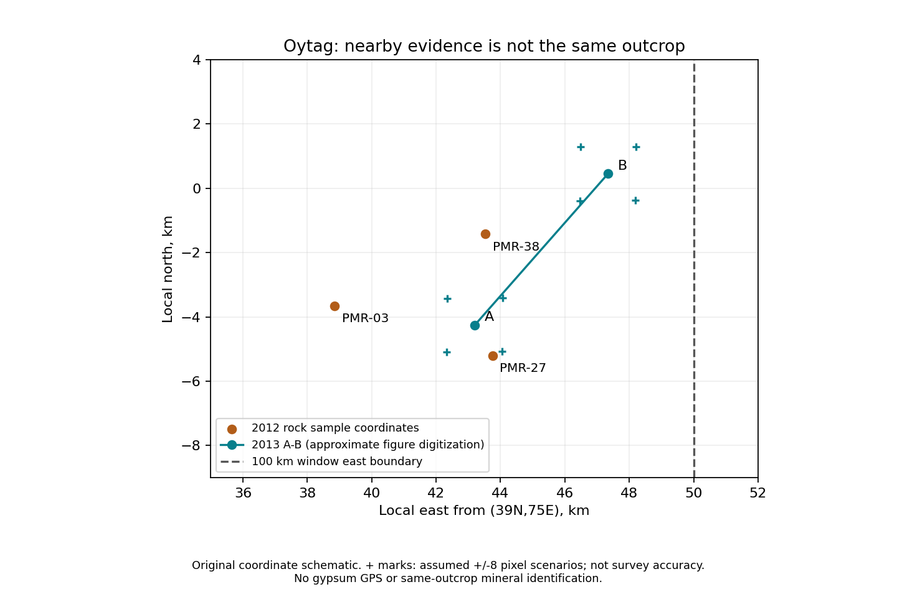

# 三組火星—地球類比候選研究報告

日期：2026-11-14（Asia/Taipei）。研究範圍：既有開放資料的區域地形候選審查。本文由 AI 協助分析，不是 NASA 官方報告、認證或現場調查。

## 摘要與結論

目前最值得投入查證的是：Gale—39°N、75°E；Arcadia 設計目標—29°N、105°W；同一 Arcadia 目標—35°N、57°E。這是三個地球候選、對應兩個火星目標，不是三個已驗證的完整環境類比。第一組在已測設定中的地形排名較穩定，後續查證已定位窗口內沉積岩樣點，但礦物與湖相類比仍未完整驗證；後兩組地形差異較小，但對尺度敏感，且缺乏地球地下冰證據。

本輪選擇規則（PROPOSED）：從已有六個具 POWER 背景的前二名候選中，優先查證地形接近、平均降水較低且設定保留度較好的區域。沒有新增全球搜尋、修改權重或重排原候選。此規則是後續研究優先順序，不是校準後的多面向分數。

## 一、資料、方法與可重現性

### 本地證據（VERIFIED）

- 候選與氣候背景（舊檔已移除；歷史來源：`outputs/analysis/results_with_context.json`）：`targets`、`candidates`、`parameters`、`sources`。
- 敏感度（舊檔已移除；歷史來源：`outputs/analysis/sensitivity.json`）：各目標的 `base_4km_top2`、`alternative_10km_top2`、`weight_variants`。
- 10 km 對照（舊檔已移除；歷史來源：`outputs/analysis_scale10km/results.json`）。
- [火星描述與來源](../outputs/mars_profiles/profiles.json)：`profiles.gale`、`profiles.arcadia` 及 `sources`。
- [地形距離函式](../analog/matching.py)：`terrain_distance`、`TOLERANCES`、`WEIGHTS`。
- [共同物理窗口](../analog/screening.py)：`local_coordinates`、`sample_patch`、`patch_features`。

既有搜尋以 2°間隔取樣地球 60°S–60°N 的候選中心，排除指定熱門區與不合陸地門檻的窗口，最後有 2,611 個合格窗口。這是稀疏搜尋，不涵蓋每個陸地位置，也未證明全球最優。每個候選代表 100 × 100 km 區域，不是精確外業落點。

地球來源為 ETOPO 2022，火星為 MGS MOLA。使用各自球半徑建構局部等距窗口，4 km 點距含邊界共 26 × 26 個取樣點；坡度內部差分跨度為 8 km。內插不代表新增解析度。三個特徵為坡度中位數、坡度第 90 百分位、窗口最大減最小高程。相同尺度上的統計接近不能證明地貌形狀或成因相同。

地形距離：

`D = 0.25 × |Δ坡度中位數| / 1° + 0.25 × |Δ坡度P90| / 2° + 0.50 × |Δ起伏| / 500 m`

D 越小表示這三項特徵越近。容許差與權重是未校準的專案設計，不是相似度百分比或機率。

POWER 氣候是候選中心所在粗網格的 2023–2024 月資料、按天數加權摘要，不是整個 100 km 窗口的實測平均。氣溫為 2 m 氣溫；降水單位 mm/day，沒有與火星原值直接配對，也未納入地形排名。兩年平均不能建立長期乾旱氣候分類。

重現本報告的證據擷取與數值檢查：

```bash
.venv/bin/python -m scripts.report_candidate_evidence
```

[機器可讀證據](../outputs/research/three_candidate_evidence.json) 保存四份輸入的 SHA-256、原候選足跡、氣候來源與火星描述，以及逐設定前二名保留情況。本輪重新計算的是既有特徵的距離，沒有重跑 DEM 特徵擷取。

## 二、三組比較總表

所有地球與火星經度均為東經正值、西經負值。

| 組別 | 地球中心 | 火星中心 | 地球／火星坡度中位數 ° | 地球／火星坡度P90 ° | 地球／火星起伏 m | 地形 D |
|---|---|---|---|---|---|---|
| A | 39, 75 | Gale：−4.59, 137.44 | 3.998／3.912 | 8.862／10.440 | 4900.2／4887.0 | 0.2319 |
| B | 29, −105 | Arcadia：40, −170 | 0.789／0.766 | 2.177／2.297 | 922.8／927.2 | 0.0252 |
| C | 35, 57 | Arcadia：40, −170 | 0.746／0.766 | 2.141／2.297 | 947.6／927.2 | 0.0448 |

| 組別 | POWER 氣溫 °C | POWER 降水 mm/day | 四個已測配置的前二名保留 | 建議用途 |
|---|---:|---:|---|---|
| A | 0.72 | 0.300 | 4/4 | 起伏與坡度分布的區域地形類比 |
| B | 21.38 | 0.346 | 3/4 | 較平緩乾燥背景下的區域地形研究 |
| C | 19.31 | 0.289 | 2/4 | Arcadia 的替代地形參照與敏感度對照 |

四個配置是原 4 km 設定、10 km 流程、偏坡度權重與偏起伏權重。保留率不是信賴度；4 km 與 10 km 的合格集合不同，因此這是整體流程敏感度，不能視為四次獨立驗證。D 不同目標間也不能直接解讀為整體研究價值排名。

## 三、A：Gale 與地球 39°N、75°E（地質查證更新）

### 3.1 更新判斷

**結論（INFERRED）**：此候選現在有窗口內的泥岩、砂岩與石灰岩文獻樣點支持，可以從純地形參照進一步研究沉積岩性。續查的經緯網地圖與地層剖面支持含石膏採樣線位於窗口內（圖上推論）；精確石膏 GPS 與同露頭礦相尚缺，不能稱為已驗證的 Gale 湖相／礦物組合類比。

先前「優先查證」的建議保留，範圍限於研究可行性，不是新的綜合排名或外業場址認可。

### 3.2 從區域背景推進到窗口內證據

既有候選四角約為 38.549–39.448°N、74.418–75.582°E，實際輪廓略有曲度，不能只用經緯度包絡框判定。

[文獻 S1：Bershaw et al.（2012）](https://doi.org/10.1016/j.jseaes.2011.04.020) 的 Table 1（期刊 p.143）列出下列三個 Oytag／Wuyitake 樣點。文獻岩性屬 EXTERNAL，本專案的空間包含計算屬 VERIFIED；沒有在本輪重新取樣。

| 文獻樣品 | 緯度 °N | 經度 °E | 文獻岩性 | 相對中心東向／北向 km | 距最近窗口邊界約 km |
|---|---:|---:|---|---|---:|
| PMR-03 | 38.9663 | 75.4494 | 泥岩 | 38.853／−3.651 | 11.147 |
| PMR-27 | 38.9521 | 75.5061 | 石灰岩 | 43.764／−5.205 | 6.236 |
| PMR-38 | 38.9861 | 75.5037 | 砂岩 | 43.535／−1.425 | 6.465 |

三點均通過局部球面方位等距座標的 ±50 km 檢查，亦落在既有候選多邊形內。它們集中於東側，不能代表整個 10,000 km²。文獻表未註明座標 datum；本輪只作約略空間歸屬，不作導航或精密測量。

S1 §4 記述含石膏地層、海相與河流相變化；剖面存在明顯構造變形。這些是剖面級紀錄，不等於三個表列樣品各自均含石膏，也不證明石膏、黏土及氧化鐵在同一露頭共現。[作者公開全文](https://web.pdx.edu/~bershaw/reference/Bershaw2012PamirCenozoicProvenanceIsotopesTarimJAES.pdf)的定位為 Table 1、§4.1–4.2；本 repo 僅存座標事實摘錄與計算結果，不轉載受版權保護的全文或圖表。

重現空間核對：

```bash
.venv/bin/python -m scripts.check_oytag_overlap
```

[座標摘錄](../outputs/research/oytag_literature_points.csv)與[包含檢查／輸入 SHA-256](../outputs/research/oytag_overlap.json)可供覆核。這不是整張地質圖的套疊，也沒有估算各岩性的面積比例。

### 3.3 與 Gale 相似到哪個層次

火星對照採具體觀測，不以整個 Gale 的平均成分替代個別鑽孔。以下文獻資料並非本專案重新分析的 XRD。

- [S2：Vaniman et al.（2014），Science，10.1126/science.1243480](https://pubmed.ncbi.nlm.nih.gov/24324271/)報告 Yellowknife Bay 泥岩鑽樣含玄武質碎屑礦物、鈣硫酸鹽與三八面體蒙皂石等成分。
- [S3：Blake et al.（2024），CheMin 團隊總結，10.3390/min14060568](https://www.mdpi.com/2075-163X/14/6/568)指出 Gale 的河流、湖泊與風成沉積記錄及後期成岩作用，並強調多數被分析岩石未經強烈加熱或變形。
- [S4：NASA，Gale 鈣硫酸鹽水合狀態研究摘要](https://ntrs.nasa.gov/citations/20170001689)區分石膏、半水石膏與硬石膏等相，以及儀器分辨限制。

| 比較問題 | 地球目前證據 | Gale 對照 | 成立程度與限制 |
|---|---|---|---|
| 宏觀地形 | 既有坡度與起伏統計接近 | 同尺度 Gale 窗口 | VERIFIED：三項統計；形態／成因仍不同 |
| 細／粗粒沉積岩 | 窗口內有泥岩與砂岩文獻樣點（S1） | 泥岩與沉積岩研究（S2、S3） | 部分成立：可研究岩性辨識；不能直接等同湖相 |
| 鈣硫酸鹽 | S5 圖示含石膏 A–B 剖面；約略採樣線落在候選內 | 硫酸鹽鑽樣／礦脈與多種水合相（S2、S4） | INFERRED：圖上定位支持窗口內；無石膏 GPS／同露頭 XRD |
| 蒙皂石／黏土 | 本輪未取得窗口內特定黏土相的可靠鑑定 | Yellowknife Bay 蒙皂石（S2） | UNKNOWN：泥岩粒度不能代替黏土礦物鑑定 |
| 赤鐵礦與磁鐵礦 | S5 全文有選定樣品的熱磁分析支持 | Gale 氧化鐵等礦物研究 | EXTERNAL：剖面級磁性解釋，不是石膏層 XRD 或同露頭共現 |
| 母岩／供源 | 窗口岩性複雜，未完成來源與礦物比例分析 | 被研究 Gale 沉積物具有玄武質成分（S2、S3） | UNKNOWN：不能以地區存在火成岩推論同樣母岩 |
| 湖泊與成岩過程 | S5 解釋部分泥岩為湖相，另有海相／河流相 | Gale 具河湖沉積及後期流體改造（S3） | 部分過程類比；需定位對應層，不能把海相石膏當 Gale 湖相成因 |

### 3.4 重要反證與不可跨越的限制

1. **成因不相同**：構造前陸盆地與撞擊坑盆地的供源、變形與埋藏史不能互換。地形穩定入選並未驗證相同沉積機制。
2. **同礦物不等於同環境**：層狀蒸發鹽與後期裂隙充填礦脈可由不同過程形成。即使後續證實雙方都有石膏，仍需比較織構、切割關係與水合狀態。
3. **尺度與代表性不同**：三個文獻樣點只確認局部存在；CheMin 鑽粉亦是局部觀測。不能把兩者外推成兩個 100 km 窗口的相同礦物比例。
4. **未確認共現**：地形、泥岩點與剖面石膏不能自動拼成同一可測試露頭。尚無共同採樣範圍與礦物組合證據。
5. **新穎性與後勤未驗證**：區內已有多篇地球地質研究，不能稱未研究地點；是否曾作火星類比、進入許可、可達性與設備條件另需查證。

### 3.5 實際值得測試的問題與下一筆資料

**可提出的研究（PROPOSED）**：「在窗口東側已報導的沉積岩露頭中，能否建立可重現的岩性與硫酸鹽產狀辨識流程，並明確區分海／河流背景與 Gale 湖相、成岩礦脈的差異？」

現已取得經緯網定位圖與含石膏剖面圖，但尚非完整數位地質圖。下一步優先取得石膏層的 GPS／地層對照與樣品編號，再對同一露頭取得既有或實測 XRD／光譜、薄片與產狀資料；若沒有蒙皂石鑑定，黏土類比維持未知。這比再增加一張整區地形圖更能改變目前的研究判斷。

可用於展示的準確句子：**「本候選與 Gale 具有相近的區域地形統計，且窗口內已有沉積岩樣點；鈣硫酸鹽的對照具有研究動機，但湖相成因、黏土組合及同露頭共現尚未驗證。」**

### 3.6 搜尋紀錄與可取得性

查詢日期為 2026-11-14。使用 Oytag／Oytagh／Wuyitake，以及 geology、gypsum、smectite、hematite 等組合，並核對 Gale CheMin 原始研究與官方摘要。S1 全文及表格文字可取得；S2 摘要、S3 頁面及 S4 官方摘要可讀。後續部分頁面逾時，不把逾時等同不存在。

Zhang et al.（2022），[10.1016/j.palaeo.2021.110796](https://dspace.library.uu.nl/handle/1874/419309)的機構摘要可取得，但完整 PDF 本輪回應 HTTP 403。故不採搜尋摘要中的 Oytag 湖相描述作已核實的窗口證據。前輪未能開啟的 Sun 與 Jiang（2013）已於本次取得全文，新的礦物證據層級以 §3.7 為準。這是有範圍的文獻核對，不是完整系統性回顧或新穎性證明。

### 3.7 含石膏剖面的圖上定位與同露頭查證（續查）

**本次答案**：圖件支持含石膏採樣線位於候選內，但這是 INFERRED 的圖上位置，不是取得石膏露頭 GPS。未找到能連接「這個石膏層的座標 → 樣品 ID → XRD／Raman／FTIR 結果」的完整證據鏈，故同露頭礦物組合維持未知。

#### 找到的圖件與證據層級

[S5：Sun & Jiang（2013），10.1016/j.tecto.2012.11.031](https://doi.org/10.1016/j.tecto.2012.11.031)，原文可從[作者機構公開 PDF](https://www.igg.cas.cn/zhuantilanmu/solid_earth/solid_earth_research/201307/W020130705569854459276.pdf)取得：

| 圖件／段落 | 可支持的判斷 | 不能支持的判斷 |
|---|---|---|
| Fig. 2，期刊 p.28（PDF 第2頁） | 經緯網、比例尺與 Gez River 沿線 A–B 採樣線的位置 | 不是逐石膏層的 GPS 表或地質多邊形 |
| Fig. 3，p.29（第3頁） | A–B 剖面及明確石膏圖例；可與定位圖連讀 | 沒有逐接觸點的地理座標，不宜依圖寬比例生成石膏座標 |
| §2、§3、§4.1 | 原文有海相蒸發鹽／湖相解釋；部分樣品作熱磁礦物判讀 | 未提供可追溯到石膏層的繞射礦相鑑定 |

這比剖面名稱的區域引用更具體，但仍不是可導航的露頭清單。

#### 本專案定位方法與結果（計算 VERIFIED；位置解釋 INFERRED）

以 PDF 第2頁 200 dpi 圖件的四個經緯網交點建立近似仿射轉換，人工讀取 A、B 線端點，投影至同一局部球面 100 km 窗口：

| 端點 | 圖讀約略位置 | 東向／北向 km | 基準判斷 |
|---|---|---|---|
| A | 約 38.961°N、75.500°E | 43.20／−4.25 | 位於窗口內 |
| B | 約 39.003°N、75.548°E | 47.34／0.45 | 位於窗口內，近東界 |

上述小數只是讀圖計算結果，不代表原文測量精度。採樣線端點及各自 ±8 pixel 的四種角落偏移，共八種診斷情境，皆落在局部窗口和既有多邊形內。這個偏移量是專案假設，不是經校準的誤差界限；不涵蓋原圖概化、datum、控制點選取或印刷形變等系統誤差，也不證明整條露頭追蹤路徑沒有偏離。

因此可合理推論：S5 沿 A–B 標出的含石膏地層在本候選窗口內；仍不能將線性插值的位置發布為「石膏 GPS」。本輪刻意不建立虛構石膏測點。



此圖由既有文獻點和本次約略讀圖座標繪製，不是衛星影像，不複製論文地質圖；2012 點與 2013 線不能當作同一露頭。

重現：`.venv/bin/python -m scripts.check_oytag_transect`。[計算紀錄](../outputs/research/oytag_transect_check.json)包含來源雜湊、繪製命令、像素原點、四個控制點、模型與診斷情境。原始受版權保護 PDF 僅在本機閱讀，沒有推入 repo。

#### 同一露頭是否有礦物鑑定？

- **S5 有儀器分析，但沒有完成石膏層的同樣品連結**：熱磁分析支持選定樣品含赤鐵礦／磁鐵礦；Ca／Sr 分析針對石灰岩，不是石膏 XRD。沒有足夠依據把這些結果加到圖示石膏層。原文未報告該層的 XRD、Raman 或 FTIR 分析，不代表其他文獻永遠沒有。
- **同名剖面不能互接**：[S6：Blayney et al.（2016），10.1002/2016TC004222](https://doi.org/10.1002/2016TC004222)，§3.1 明確區分 Bershaw 的 Oytag River 剖面與 Sun/Jiang 的平行 Gez River 剖面，並討論年代不確定性。[機構全文](https://eprints.lancs.ac.uk/id/eprint/82403/1/Blayney_et_al_2016_Tectonics.pdf)。不能因地名一致，就把前輪 PMR 點作為 S5 石膏層的採樣 ID。
- **另有分析線索，仍未達條件**：[S7：Bershaw 2010 教學專題](https://www.hajim.rochester.edu/optics/sites/cml/opt307/spr10/john/index.html)記述 PMR-26、PMR-40 等樣品的薄片與 SEM／X-ray spectra。其內容是初步、非同儕審查材料；展示元素能譜不能當作已取得粉末 XRD 圖譜，也沒有證實樣品來自上述石膏層，故不作同露頭礦物確認。

對 Gale 的意義限於「有可定位的含硫酸鹽沉積剖面供後續研究」。海相層狀蒸發鹽與 Gale 的成岩硫酸鹽脈不能等同；同樣尚未證實石膏與蒙皂石同場共現。

**下一個最有用的證據**：原作者的 A–B 路線／石膏接觸點 GPS、層位高度與對應樣品編號，接續同一樣品的礦相資料。若無既有資料，需經許可的定點取樣與礦物分析；目前沒有聯絡作者或安排外業。

本輪完成對 S1、S5、S6 全文與圖件的有範圍檢查，並搜尋 Oytag/Wuyitake 搭配 gypsum、XRD、Raman、supplementary 等詞。Fig. DR1 補充圖仍未取得；本次新取得的是 Table DR1，詳見 §3.8。來源與可取得性詳見[查證清單](../outputs/research/oytag_outcrop_source_audit.json)。

### 3.8 原始補充資料、樣品 ID 與礦物鑑定追查

**續查結論**：已取得原始補充表的座標與樣品編號，但它們是鋯石定年的母岩採樣資料，不是石膏層 GPS。沒有找到能連起同一石膏露頭的座標、ID 與礦相結果；§3.7 的圖上位置推論維持原層級。

#### 已實際取得 Table DR1

S1 的出版者公開 [mmc1.xls](https://ars.els-cdn.com/content/image/1-s2.0-S1367912011001878-mmc1.xls) 已成功下載並解碼。用 DOI 的 Crossref 紀錄核對出版者 PII，再核對檔內表名與 PMR 樣品系統：唯一工作表 `ZirconData`，912 列、17 欄，表名為鋯石 U–Pb 分析；可辨識十組母岩座標。

[摘錄 CSV](../outputs/research/oytag_supplement_coordinates.csv)保留工作表名稱、Excel 列號、樣品類型、原始座標與候選歸屬；[來源紀錄](../outputs/research/oytag_supplement_metadata.json)保留原檔 SHA-256 與實際大小。沒有重新散布整份原始 Excel。

| 母岩 ID | 緯度 °N（顯示至6位） | 經度 °E（顯示至6位） | 與石膏層關聯 |
|---|---:|---:|---|
| PMR-01 | 38.993700 | 75.543400 | 未建立 |
| PMR-08 | 38.747970 | 75.185286 | 火成岩來源樣品，未建立 |
| PMR-13 | 39.018099 | 74.635236 | 未建立 |
| PMR-20 | 38.737967 | 75.033371 | 未建立 |
| PMR-23 | 38.892725 | 75.494302 | 火成岩來源樣品，未建立 |
| PMR-25 | 38.971549 | 75.468114 | 未建立 |
| PMR-26 | 38.974448 | 75.475797 | 可對照 S7 薄片 ID，但未連到石膏層 |
| PMR-33 | 38.983679 | 75.516773 | 未建立 |
| PMR-40 | 38.986588 | 75.499688 | 可對照 S7 薄片 ID，但未連到石膏層 |
| PMR-46 | 38.989678 | 75.539942 | 未建立 |

十組均落在既有候選多邊形內（VERIFIED 計算）；資料欄位是 Latitude／Longitude，未交代 datum 或量測儀器，故不能升級成已確認的現場 GPS 精度。`PMR-40-1` 等是母岩中的單顆鋯石分析 ID，不是新增的露頭。

**找到座標不等於找到目標樣品**：補表的分析對象是鋯石年代，不是石膏或黏土礦相；相同 PMR 母岩編號只能幫助追溯 S7 的薄片線索，不能把其初步石英／長石描述變成古近紀石膏層的礦物鑑定。Fig. DR1 的補充地圖本輪仍未取得；Table DR1 與 Fig. DR1 不可混稱已完成。

#### 找到礦物表，但不是同一露頭

[S8：Chang et al.（2000），10.2343/geochemj.34.407](https://www.jstage.jst.go.jp/article/geochemj1966/34/6/34_6_407/_article)的 Table 1 將 `9412-1` 列為 Oytag 黑色冰磧基質，位置編號 `133`。Table 2 的石膏 abundance 欄為 `1`，其相對石英的 `Gy/Q` 欄卻為 `0`；這兩欄不可混為同一檢出標準，不能只截取「1」就宣稱強 XRD 證據。更重要的是：它是冰川搬運的混合物，沒有與 S5 圖示古近紀石膏層對應的樣品 ID 或 GPS。故列為**排除的同名礦物線索**，沒有加進候選的確認礦物矩陣。

#### 證據鏈逐環節狀態

| 必要環節 | 本輪取得 | 對同一石膏露頭的判斷 |
|---|---|---|
| 含石膏地層位置 | S5 圖上採樣線 | INFERRED；沒有實測接觸點 |
| 原始樣品座標 | S1 Table DR1 十組 | VERIFIED 摘錄；非石膏層樣品 |
| 石膏層唯一樣品 ID | 尚未找到 | UNKNOWN |
| 同樣品 XRD／Raman／FTIR | 尚未找到 | UNKNOWN |
| 其他同地名礦物資料 | S7 薄片、S8 冰磧物 | 無法跨剖面／材料接入 |

**補充檔的取得限制**：ScienceDirect／Wiley 文章頁本輪回應 403；Elsevier API 雖回應 200，只有書目 metadata，沒有全文或附檔清單。少量推測檔名的 404 不能證明補充資料不存在；只有實際下載且讀取成功的 `.xls` 被列為已取得。[查詢紀錄](../outputs/research/oytag_supplement_access_log.json)區分推測 URL、HTTP 結果與內容核實。沒有繞過登入、聯絡作者或要求寄送資料。

#### 重現與下一步

原始 `.xls` 不隨 repo 發布；取得上方公開來源後，可用選用的 `xlrd==2.0.1` 讀取：

```bash
.venv/bin/python -m pip install xlrd==2.0.1
.venv/bin/python -m scripts.extract_oytag_supplement --input /path/to/mmc1.xls
```

本輪 reader 安裝在臨時目錄，沒有更動專案核心依賴。實際解碼十組座標並核對唯一 ID、欄位範圍與多邊形歸屬；只是重現摘錄，不重跑排名。

下一步應直接取得 **Sun/Jiang A–B 石膏層的接觸點座標、層位高度、採樣 ID 和該 ID 的礦相報告**。若只取得 S1 更多鋯石數據，仍不能解決這個缺口。本次搜尋已帶來原始座標進展，但尚不能把「窗口內有圖示石膏剖面」升級成「同露頭已驗證 Gale 礦物組合」。

## 四、B：Arcadia 與地球 29°N、105°W

**區域定位**：墨西哥北部 Chihuahua 區域的候選窗口；具體地質單元與沙漠生態邊界仍待覆核，不把它改名為已知沙丘或試驗站。

**可支持的相似性（VERIFIED）**：起伏差約 4.4 m，坡度中位數差約 0.023°，P90 差約 0.120°。在此地形定義下接近專案 Arcadia 設計窗口，但不表示絕對平坦；約 923 m 是整個 100 km 區域起伏。

**火星背景（EXTERNAL）**：[NASA Arcadia 冰資源研究介紹](https://www.nasa.gov/solar-system/nasas-treasure-map-for-water-ice-on-mars/?site=msl)說明該區的冰研究價值；[Arcadia 雷達與地貌原始研究](https://doi.org/10.1029/2018JE005663)提供區域研究背景。這些區域結論不能直接指定本專案 40°N、170°W 每個位置的冰深度。

**地球背景（EXTERNAL）**：[NASA Chihuahua 區域沙塵事件](https://science.nasa.gov/earth/earth-observatory/dusty-days-are-here-again-for-el-paso-154230/)顯示更廣區域存在乾湖等沙塵源。該事件不在本候選中心，不能作為候選本身的沙塵頻率或光學厚度證據。

**可設計的研究（PROPOSED）**：驗證「三項地形統計相近，但地表材料／環境不同」時，粗尺度地形篩選會遺漏什麼。精細通行、鑽探或沙塵設備測試需獨立取樣與高解析度資料。

**重要不匹配**：目前沒有此地球窗口的地下冰證據，21.38°C 的背景也不能支持低溫冰環境類比。不得推薦為 Arcadia 水冰 ISRU 的完整自然場址。

**穩定性**：兩個權重配置仍保留，但 10 km 流程退出前二名。其非常低的 D 不能掩蓋尺度敏感性。

## 五、C：Arcadia 與地球 35°N、57°E

**區域定位**：伊朗內陸 100 km 候選窗口。未確認與 Dasht-e Kavir 鹽沼、Lut 雅丹或其他具名地貌的實際重疊，不能直接套用那些地點的礦物或地貌。

**可支持的相似性（VERIFIED）**：起伏差約 20.4 m，坡度中位數差約 0.020°，P90 差約 0.156°。POWER 降水摘要為三組最低，但不同區域粗網格與兩年期間不支持將此差異誇大為長期乾旱程度排序。

**區域文獻（EXTERNAL）**：[NASA 伊朗大鹽漠說明](https://science.nasa.gov/earth/earth-observatory/irans-great-salt-desert-80435/)可作地區背景參考，尚不構成本候選的鹽類、古湖或礦物證據。

**可設計的研究（PROPOSED）**：作為 B 的替代地形參照，檢查低地形距離是否能跨不同地質背景重現；補上礦物圖後，才評估鹽類或風成作用的研究價值。

**主要缺口與不匹配**：地下冰、沙塵、礦物、地質與後勤皆未確認。19.31°C 背景不能代表 Arcadia 冷地環境。只在四個配置中的兩個保留前二名，不應與 A 宣稱相同穩定程度。

## 六、為何本次沒有給 Jezero 一個強制配對

既有 Jezero 前兩名在 57°N、161°E 與 13°N、37°E，POWER 平均降水為 2.513 與 7.692 mm/day。這不證明它們不能研究任何古水文問題，但不足以推薦為現代乾燥環境類比。地形資料也沒有驗證三角洲形態與礦物。應保留為地形參照，不把本報告三個名額硬分給三個火星目標。

若需要三個不同火星目標，Jezero 必須另做具有古湖／三角洲地質證據的搜尋，不能把外部知名場址直接替換進既有排名。Qaidam 已有明確類比文獻，例如 [Xiao et al. 2017](https://doi.org/10.1002/2017JE005293)，可作方法基準而非宣稱新發現；本輪沒有對它新增計算或評分。

## 七、後續查證順序與決策限制

1. A：已有窗口東側文獻點與含石膏剖面的圖上定位；下一步是石膏層 GPS、樣品 ID 與礦相資料，不升級為已驗證的同露頭礦物類比。
2. B：優先取得較細 DEM 與材料證據，釐清尺度敏感原因；若目標是冰鑽探，應另找有地球地下冰證據的場址。
3. C：先完成精確地理／地質定位，再考慮礦物與風成過程。其額外價值尚待確認，不是已證實互補。

所有候選皆標為「本專案提出、尚待驗證」。本輪文獻搜尋是區域背景核對，沒有完成針對各足跡與所有地名別名的系統性文獻盤點，不能宣稱 under-studied 或全球首創。未查核許可、費用、季節可達性，不建議直接安排外業。

地球無法天然重現火星重力、低壓大氣與輻射環境。未知資料沒有轉成確認符合。現有結果不是整體火星相似度、任務成功率或著陸安全證明。

## 八、本輪交付與驗證

- 已完成：三組候選研究報告、原始候選足跡／來源／雜湊的 JSON 摘錄，以及三個地形距離的公式重算。
- 探索／推論：區域地名、任務用途與查證優先順序。
- 待確認：精確地質、礦物、文獻使用史、地球冰／溫度／沙塵及後勤。
- 尚未完成：重新全球搜尋、四面向評分、現場驗證與三個不同火星目標的完整配對。

本輪沒有重新生成 DEM 特徵、下載重型科學產品或修改既有排名。AI 協助資料核對、來源搜尋、可重現摘錄與中文撰寫；外部資料以文內來源為準。

### 2026-11-14 地質補查交付

已補入窗口內三個文獻樣點、局部座標及多邊形雙重檢查、Gale 礦物證據矩陣、反證與來源可取得性。沒有修改既有候選排名、氣候或地形數值；未取得完整礦物圖、未執行新 XRD 或現場採樣。本輪新腳本只驗證座標歸屬，不能驗證礦物存在。

### 2026-11-14 含石膏剖面續查交付

已讀取 S5 Fig.2／Fig.3、近似定位 A–B、完成八種端點偏移診斷與原創示意圖，補入剖面差異及分析方法限制。已執行兩支座標核對腳本；本輪未重新排名、採樣或進行礦物量測。

### 補充檔續查交付

已取得並解析 Table DR1、保存十組座標摘錄、來源雜湊與存取結果；另核對並排除同名冰磧物的礦物表。未取得石膏層 GPS／ID／同樣品礦相。既有排名、原始地形與氣候數值維持不變。
