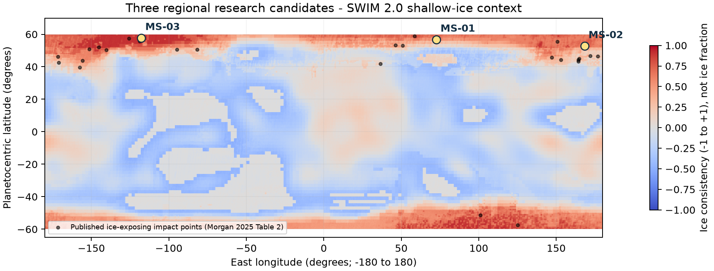

# 火星三點重新選址報告
Team zasa | MARS-RESELECT-20261114-v1 | 2026-11-14（Asia/Taipei）

## 結論
本輪重新選出三個供淺層冰探查研究的區域候選。已把全部既有火星資料分成選點比較、背景、品質不足或無對應位置四種角色；沒有把所有欄位硬合成總分。
在本報列明的目錄、座標表與具名提案範圍內，未確認三個名義格與已知具體場址重複。完整補表及部分歷史提案幾何仍缺，不能保證全世界從未研究或提出過。三點不是已確認冰藏、採冰方案或獲准登陸/基地地點。

| 候選 | 中心座標 | 用途價值 |
|---|---|---|
| MS-01 | 56.75N, 72.75E | 雙深度冰線索與低起伏並存 |
| MS-02 | 52.75N, 168.25E | 較低緯度的冰探查取捨 |
| MS-03 | 57.75N, 242.25E | 較低沙塵、低坡度與強近表層線索 |

## 怎麼重新找
掃描172,800個0.5°格；172,581格具有效核心描述；在兩深度SWIM>0、非舊八個候選格/舊排除框的探索規則下得58,238格。六目標非支配前緣有453格，抽22格供審查，再對4格做原生QA，選A/D/C為三案例。
六目標為淺層/深層SWIM較高、區域坡度/高差較低、MY34/MY35沙塵p95較低。無權重、無總分；探索方向和目標仍屬本研究設計，不是經驗證的工程門檻。TES、高程、MCS、分季/極值/可靠度均有考慮，但因沒有單調最佳值或QA不足，保留背景而不強行評分。
北緯51°以上只是待查候選的抽樣優先安排，不是物理限制或新穎性條件。三點最終以具體價值、資料及已列先例取捨選擇；不宣稱全域最佳。

## 所有資料的使用帳
| 面向 | 資料 | 本輪用途 | 限制 |
|---|---|---|---|
| 地形 | MOLA高程、坡度、高差 | 比較/原生核對 | 約3.7km；不能判米級障礙或安全 |
| 熱性質 | TES熱慣量及插值遮罩 | 背景/有效比例 | 約3km；沒有單調最佳值；不是溫度/硬度 |
| 水/冰 | SWIM 0-1m與1-5m | 兩個探索目標 | 共享原始證據；不是冰量或獨立互證 |
| 大氣/沙塵 | MY34/MY35均值、p95、極值、分季、可靠度 | p95比較；其餘作背景 | 原生3°重建；不是局部風、沉積或氣壓 |
| 溫度 | MCS MY29-36；03/15 LTST | 粗背景/缺值揭露 | 5°校時衍生值；QA/不確定度/樣本數缺失 |
| 探測車 | MEDA局部亮溫等159418列 | 品質與尺度參照 | Jezero局部且完整QA合格0列；不移植 |
| 未取得 | 局部風壓、材料、冰真值、細地形等 | 明列未知 | 沒有數值，不補造或視為條件通過 |

## 三點比較（原生格）
| 候選 | 平均坡度° | 高差m | SWIM 0-1m / 1-5m | TES熱慣量 |
|---|---|---|---|---|
| MS-01 | 0.287 | 76 | 0.639 / 0.647 | 325.2 |
| MS-02 | 0.302 | 117 | 0.693 / 0.622 | 217.3 |
| MS-03 | 0.163 | 76 | 0.911 / 0.510 | 152.8 |

TES單位J m^-2 K^-1 s^-0.5；SWIM為一致性而非百分比。全球粗化/插值stack值與名義格內原生格統計不同，本表採後者。
MOLA64/64只表示格值有限；MEGDR原產品含無軌跡處插值，本輪未取得雷射觀測密度遮罩，不能把有效格當成全部直接量測或品質全面合格。
三點皆高於50°N，不符合MCOA2025所用±50°或SkyFall目前0-45°N的緯度條件。本輪定位為冰探查研究候選；高緯熱控、供電與冬季限制仍需評估，不能直接提交為這兩組設計的合格場址。

## MS-01：雙深度冰線索與低起伏並存
位置：56.75°N、72.75°E。範圍：56.5-57.0°N、72.5-73.0°E，約29.64×16.25 km。這是分析單元，不是實地測區/鑽孔/著陸橢圓。

**為什麼選：**兩深度冰一致性都相對高，區域坡度與高差低；適合提出覆土與冰相關熱訊號的後續探查問題。

**要研究什麼：**在兩深度冰線索均較強、較高熱慣量的區域，哪些局部影像、雷達與熱觀測能區分表層材料和地下冰的影響？

**缺點與未知：**三點中熱慣量最高，但這不等於較硬、較好鑽或冰較多。TES有27個插值格被排除；局部材料與冰界面仍未知。

| 面向 | 數值與有效支撐 | 能說到哪裡 |
|---|---|---|
| 地形 | MOLA64/64；平均高程-3700.9m；坡度0.287207°；高差76m | 約3.7km尺度；非局部障礙/安全 |
| 熱性質 | TES 325.1557；有效73/100；範圍287-373 | 排除插值；非溫度/硬度 |
| 冰線索 | 0-1m 0.639225；1-5m 0.647482；各100/100有效 | 共享來源，非獨立互證；無真實冰量/冰深 |
| MY34沙塵 | 均值0.119264；p95 0.222456；最大0.365110；可靠度均值0.883847 | 669/669重建sol；最近3°格(55.5,72.0)；可靠度非機率 |
| MY35沙塵 | 均值0.107535；p95 0.180147；最大0.342228；可靠度均值0.888089 | 669/669重建sol；最近3°格(55.5,72.0)；可靠度非機率 |
| MCS溫度背景 | 最近5°格(55.0,75.0)；15h/03h有值中位247.48/173.73K；配對差中位63.54K | 日161/288、夜145/288、共同69/288；非同sol/全年/局部實測，QA與不確定度未知 |

**資料仍不能回答：**冰存在/深度/純度/連續性、風壓、地面承載力/岩石率、礦物及細地形真值、可採能耗、設備性能與現況。

### 沙塵季節背景
| Ls區間 | MY34均值/sol數 | MY35均值/sol數 |
|---|---|---|
| 0_90 | 0.123628 / 193 | 0.134394 / 193 |
| 90_180 | 0.100450 / 179 | 0.092037 / 178 |
| 180_270 | 0.166168 / 143 | 0.102124 / 143 |
| 270_360 | 0.092111 / 154 | 0.096880 / 155 |

## MS-02：較低緯度的冰探查取捨
位置：52.75°N、168.25°E。範圍：52.5-53.0°N、168.0-168.5°E，約29.64×17.94 km。這是分析單元，不是實地測區/鑽孔/著陸橢圓。

**為什麼選：**三點中最靠近赤道，兩深度冰線索均為正且相對高，TES原生有效格比例最高；適合比較緯度、熱背景與冰線索的取捨。

**要研究什麼：**較低緯度但較高沙塵背景的候選，能否用新增局部觀測釐清淺層冰線索與季節熱背景，而不借用南方既有場址真值？

**缺點與未知：**三點中區域高差較大，MY34沙塵p95及最大值也最高。較低緯度不等於已證明供電、熱控或登陸可行。Phlegra大區已有研究。

| 面向 | 數值與有效支撐 | 能說到哪裡 |
|---|---|---|
| 地形 | MOLA64/64；平均高程-3898.7m；坡度0.301845°；高差117m | 約3.7km尺度；非局部障礙/安全 |
| 熱性質 | TES 217.2690；有效93/100；範圍177-276 | 排除插值；非溫度/硬度 |
| 冰線索 | 0-1m 0.692987；1-5m 0.622499；各100/100有效 | 共享來源，非獨立互證；無真實冰量/冰深 |
| MY34沙塵 | 均值0.125384；p95 0.240015；最大0.452530；可靠度均值0.882074 | 669/669重建sol；最近3°格(52.5,168.0)；可靠度非機率 |
| MY35沙塵 | 均值0.110066；p95 0.173120；最大0.315187；可靠度均值0.886520 | 669/669重建sol；最近3°格(52.5,168.0)；可靠度非機率 |
| MCS溫度背景 | 最近5°格(55.0,170.0)；15h/03h有值中位246.31/171.27K；配對差中位66.83K | 日175/288、夜143/288、共同75/288；非同sol/全年/局部實測，QA與不確定度未知 |

**資料仍不能回答：**冰存在/深度/純度/連續性、風壓、地面承載力/岩石率、礦物及細地形真值、可採能耗、設備性能與現況。

### 沙塵季節背景
| Ls區間 | MY34均值/sol數 | MY35均值/sol數 |
|---|---|---|
| 0_90 | 0.129452 / 193 | 0.141164 / 193 |
| 90_180 | 0.109139 / 179 | 0.106618 / 178 |
| 180_270 | 0.153406 / 143 | 0.090445 / 143 |
| 270_360 | 0.113148 / 154 | 0.093405 / 155 |

## MS-03：較低沙塵、低坡度與強近表層線索
位置：57.75°N、242.25°E。範圍：57.5-58.0°N、242.0-242.5°E，約29.64×15.81 km。這是分析單元，不是實地測區/鑽孔/著陸橢圓。

**為什麼選：**三點中區域平均坡度最低，MY34與MY35的沙塵均值及p95也最低，近表層SWIM線索較強；提供不同熱性質背景的探查對照。

**要研究什麼：**較低熱慣量與較強近表層冰線索並存時，覆土與地表材料可能造成哪些判讀歧義，應先取得什麼局部證據？

**缺點與未知：**1-5m指標低於另外兩點；TES僅79/100原生格有效，熱慣量範圍較寬。溫度粗格偏北且缺測多；不能推論冰量、硬度或設備性能。

| 面向 | 數值與有效支撐 | 能說到哪裡 |
|---|---|---|
| 地形 | MOLA64/64；平均高程-2548.3m；坡度0.162753°；高差76m | 約3.7km尺度；非局部障礙/安全 |
| 熱性質 | TES 152.8077；有效79/100；範圍111-270 | 排除插值；非溫度/硬度 |
| 冰線索 | 0-1m 0.910904；1-5m 0.509972；各100/100有效 | 共享來源，非獨立互證；無真實冰量/冰深 |
| MY34沙塵 | 均值0.098215；p95 0.173362；最大0.319893；可靠度均值0.861479 | 669/669重建sol；最近3°格(58.5,-117.0)；可靠度非機率 |
| MY35沙塵 | 均值0.088660；p95 0.140962；最大0.186960；可靠度均值0.879484 | 669/669重建sol；最近3°格(58.5,-117.0)；可靠度非機率 |
| MCS溫度背景 | 最近5°格(60.0,-120.0)；15h/03h有值中位234.95/154.58K；配對差中位67.05K | 日171/288、夜148/288、共同60/288；非同sol/全年/局部實測，QA與不確定度未知 |

**資料仍不能回答：**冰存在/深度/純度/連續性、風壓、地面承載力/岩石率、礦物及細地形真值、可採能耗、設備性能與現況。

### 沙塵季節背景
| Ls區間 | MY34均值/sol數 | MY35均值/sol數 |
|---|---|---|
| 0_90 | 0.105538 / 193 | 0.108021 / 193 |
| 90_180 | 0.083856 / 179 | 0.079132 / 178 |
| 180_270 | 0.120824 / 143 | 0.083011 / 143 |
| 270_360 | 0.084731 / 154 | 0.080707 / 155 |

## 有範圍的既有場址查核
| 來源 | 本輪判定及範圍 |
|---|---|
| N1 NASA EMC EZMars | 381 ROI與51 EZ已查快照北界分別47.403315/47.851044N，三格南界更北；沿用固定main的既有完整幾何查核；本輪未重取；非所有歷史提案 |
| N2 SWIM4MIM RZ | 提供者頁確認是具體優先區；已驗幾何快照北界51.217655N，三格在外；頁面本輪重讀；幾何北界是繼承快照，非本輪新下載；工程裁切變體未完整排除 |
| N3 Mashal等2025 MCOA | 原文方法與Figure8/TableA3表明23優先區限±50度，三格不在其範圍；是此研究已選優先區範圍；不把人類工程限制套成本輪要求 |
| N4 Morgan等2025 Table2 | 原文索引完整26點，root逐格查無表內點；另算最近點中心距；是已知露冰點表而非研究足跡；未讀全文；完整表轉錄見附件 |
| N5 Dundas等2014 Table1 | 查核讀取原文20點，未見點落A/D/C格；點表不是完整影像/研究範圍 |
| N6 Dundas等2021 | 本文具體冰崖點/圖說與候選分離，包括Milankovic約54.5N213.5E及57N95.7E；S1-S4完整補表及ScienceBase原始全表未取得，不宣稱全目錄排除 |
| N7 NASA SkyFall 2026 AP-105 | 具體設計參考場址43.3295N198.5228E，名義100x25km橢圓；與三格分離；不是SkyFall最終選址；五廣域評估區不等於每個點都被選定 |
| N8 2015 Phlegra基地提案1002 | 原文具體39N172E與列明49N126E/49.5N160E/47N347E均不是三格；廣域Phlegra研究仍存在；原提案部分延伸ROI未完整幾何化 |
| N9 2020 Phlegra候選6008 | 具體影像搜尋30-40N160-166E，圖例38.7N163.88E；與MS-02分離；Phlegra大區地質研究曾延伸30-52N；不能把大區當新研究區 |
| N10 NASA ODE existing/proposed landing sites | 已讀公開座標頁，未有列明中心落入三格；該頁不是所有現代任務/歷史提案的最新完整足跡庫；中心不代表完整橢圓 |
| N11 NASA 2015 abstract1018 | 原文明示ROI40-50N160-190E及46.16N188.8E場址，三格不在ROI；僅限該明示ROI；不借用其冰深/資源值 |

26個已知露冰點的同格檢查與中心距離計算保存於bounded_prior_site_audit.json；距離只作背景，不取代範圍相交。B不列三點是保守取捨，沒有因近29km就宣判重複。

### 精確檢索字串與停止範圍

- MS-01：Mars "56.75" "72.75"；Mars Utopia "56" "72" ice landing site exploration；Mars "56" "73" "landing site" ice

- MS-02：Mars "52.75" "168.25"；Mars "52" "168" "ice" "landing"；Mars Phlegra "53" "168" ice exploration；Mars "Phlegra" "52" "landing"；Mars "Phlegra" "53" "exploration zone"

- MS-03：Mars "57.75" "242.25"；Mars "57.75" "-117.75"；Mars Alba "58" "242" ice crater scarp；Mars "58" "242" "landing site" ice

完成上述具名目錄/指定表格與每候選一輪座標、區域別名、用途查詢後停止。非命中不升格為從未研究；完整補表、歷史替代EZ與未公開提案仍有缺口。

## 重現與交付
- 篩選：.venv/bin/python -m scripts.research.mars_reselection_20261114
- 原生提取：.venv/bin/python -m scripts.research.mars_reselection_20261114 --finalize-targets outputs/research/mars_reselection_20261114/fixed_targets.json
- 報告：.venv/bin/python -m scripts.reporting.build_mars_reselection_report
- 驗證見numerical_validation.json、report_validation.json；輸入hash見method.json及candidate_native_evidence.json。
- 本輪結果僅本機生成；未合併、推送、部署或正式提交。既有MR-v3/EH/Excel未重做或覆寫。
- 原量測歸原資料作者。本輪AI協助程式、資料盤點與文字，實際以Mac CPU運算，未使用GPU、模型訓練或新地面觀測。
- 沙塵衍生部分依Montabone來源CC-BY-SA-3.0；其他資料依各提供者條款，不替整個專案另行授權。
- 本報完成的是火星候選重選；Earth↔Mars的新地球類比場址目標仍需另行完成。

- preservation_check.json另核對既有MR-v3/EH檔與固定main Git blob、Excel與既有驗收hash；與Mars輸入manifest的保護範圍分開。
- final_candidates.csv的native_review_status保留原生QA交接狀態；final_selection_status才表示本報完成限定查核後保留，不回寫原生輸入狀態。

## 來源與實際閱讀範圍
- [S1 MOLA PDS 原生高程與標籤](https://pds-geosciences.wustl.edu/mgs/urn-nasa-pds-mgs_mola_topography_derived/meg016/)：本機原檔及標籤；來源hash已核對。
- [S2 TES 夜間熱慣量與插值遮罩](https://pds-geosciences.wustl.edu/mgs/mgs-m-tes-5-timap-v1/mgst_9001/data/)：本機IMG/LBL；排除mask=0。
- [S3 SWIM 2.0 提供者產品說明](https://swim.psi.edu/SWIM2Products.php)：提供者頁與本機兩深度GeoTIFF；2021產品。
- [S4 Montabone 火星沙塵重建產品](https://doi.org/10.1029/2019JE006111)：本機MY34/MY35 v2.5；3°、669 sols/年。
- [S5 Wang/Jin MCS 校時溫度資料](https://doi.org/10.5281/zenodo.17947556)：版本固定；本機MD5/SHA；5°背景。
- [S6 MEDA/PDS 儀器與品質參照](https://doi.org/10.17189/1522849)：既有159418列QA紀錄；不移植至新點。
- [N1 NASA EMC EZMars 2015提案目錄](https://trek.nasa.gov/mars/trekarcgis/rest/services/EZMars/MapServer)：沿用已查381 ROI/51 EZ幾何北界；本輪端點重取失敗。
- [N2 SWIM4MIM 已選冰探查RZ](https://swim.psi.edu/SWIM4MIMProducts.php)：本輪提供者頁；幾何北界沿用已驗快照。
- [N3 Mashal等2025優先探索區](https://doi.org/10.3847/PSJ/ade30e)：原文索引§2、Figure2/8及TableA3；23區限±50°。
- [N4 Morgan等2025已知露冰點](https://doi.org/10.3847/PSJ/ad9b24)：原文索引Table2完整26行；不是全文讀取。
- [N5 Dundas等2014露冰撞擊點](https://doi.org/10.1002/2013JE004482)：原文Table1的20點。
- [N6 Dundas等2021冰暴露研究](https://doi.org/10.1029/2020JE006617)：本文具體點/圖說；S1-S4補表未取得。
- [N7 NASA SkyFall 2026參考場址](https://science.nasa.gov/wp-content/uploads/2026/09/skyfall-mission-information-package-final.pdf)：9頁原始文件；SectionVII AP-105。
- [N8 2015 Phlegra基地提案1002](https://www.hou.usra.edu/meetings/explorationzone2015/pdf/1002.pdf)：原始2頁；39N172E及列明高緯備選。
- [N9 2020 Phlegra候選研究6008](https://www.hou.usra.edu/meetings/marspolar2020/pdf/6008.pdf)：原始2頁；具體搜尋與圖例點在更南方。
- [N10 NASA ODE既有/擬議著陸點](https://ode.rsl.wustl.edu/mars/pagehelp/Content/Missions_Instruments/Landing_Sites.htm)：公開座標頁；不是最新所有任務完整足跡目錄。
- [N11 2015冰資源提案1018](https://ntrs.nasa.gov/api/citations/20150020456/downloads/20150020456.pdf?attachment=true)：原始1頁；ROI40-50N、160-190E。
